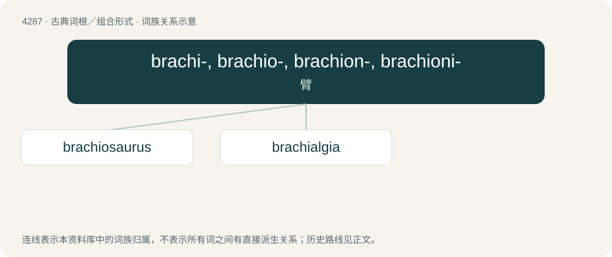

# 4289 · brachi-, brachio-, brachion-, brachioni- — 臂

[总目录](../00_总目录_按常用程度.md)

**类型**：古典词根／组合形式　｜　**来源语言**：古希腊语

## 核心含义与来源

- 核心含义：臂
- 英文含义：arm
- 词形：brachi-, brachio-, brachion-, brachioni-

**来源词形**：βραχίων (brakhíōn)

## 词族图

## 单词速览（常用到不常用）

| 单词 | 音标 | 释义 |
|---|---|---|
| [brachiosaurus](#w-1) | /ˌbrækiəˈsɔːrəs/ | n. （古生物）腕龙 |
| [brachialgia](#w-2) | /,breikiˈældʒiə/ | 臂神经痛 |

## 逐词详解

### 1. brachiosaurus

**词性**：名词　｜　**音标**：/ˌbrækiəˈsɔːrəs/

**中文释义**：n. （古生物）腕龙

**英文义项**：A large herbivorous sauropod dinosaur, Brachiosaurus altithorax, which lived during the Late Jurassic in North America.

**构词拆分**：brachio- + -saurus

**词源与演化**：

Borrowed from taxonomic name Brachiosaurus, from brachio- + -saurus; literally “arm lizard”, relating to the great length of its forelegs compared to its hindlegs.

### 2. brachialgia

**词性**：名词　｜　**音标**：/,breikiˈældʒiə/

**中文释义**：臂神经痛

**英文义项**：pain in the arm

**构词拆分**：brachio- + -algia

**词源与演化**：

From brachi- + -algia.

## 其他候选词

- brachionerysipelas
- brachionigraph
- brachiorrhachidian
