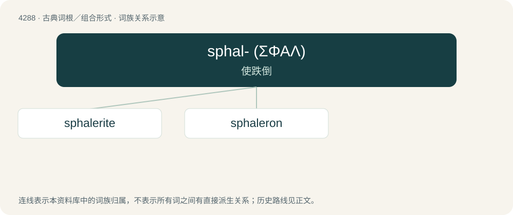

# 4290 · sphal- (ΣΦΑΛ) — 使跌倒

[总目录](../00_总目录_按常用程度.md)

**类型**：古典词根／组合形式　｜　**来源语言**：古希腊语

## 核心含义与来源

- 核心含义：使跌倒
- 英文含义：cause to fall
- 词形：sphal-

**来源词形**：σφάλλειν (sphállein), σφαλερός (sphalerós), σφαλλόμενον

## 词族图

## 单词速览（常用到不常用）

| 单词 | 音标 | 释义 |
|---|---|---|
| [sphalerite](#w-1) | 美 /ˈsfeɪ.ləˌɹaɪt/；/ˈsfæl.əˌɹaɪt/ | n. \[矿\]闪锌矿 |
| [sphaleron](#w-2) |  | 【英文】The particle-like solution to an electroweak field equation. |

## 逐词详解

### 1. sphalerite

**词性**：名词　｜　**音标**：美 /ˈsfeɪ.ləˌɹaɪt/；/ˈsfæl.əˌɹaɪt/

**中文释义**：n. \[矿\]闪锌矿

**英文义项**：A yellow, brown or black, sometimes red, green white or colorless mineral with cubic crystals, of a chemical formula (Zn,Fe)S, often containing also minor metals, such as cadmium, gallium, germanium and indium.

**构词拆分**：Ancient Greek σφαλερός (sphalerós, “unstable, unsteady, precarious”) + -ite

**词源与演化**：

From Ancient Greek σφαλερός (sphalerós, “unstable, unsteady, precarious”) + -ite; named in 1847.

### 2. sphaleron

**词性**：名词

**英文义项**：The particle-like solution to an electroweak field equation.

**词源与演化**：

From σφαλερός (sphalerós, “slippery”) + -on.
