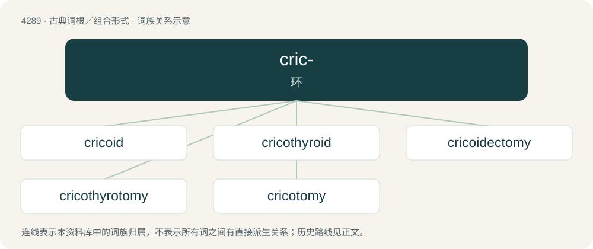

# 4291 · cric- — 环

[总目录](../00_总目录_按常用程度.md)

**类型**：古典词根／组合形式　｜　**来源语言**：古希腊语

## 核心含义与来源

- 核心含义：环
- 英文含义：ring
- 词形：cric-

**来源词形**：κρίκος (kríkos), κρικοειδής (krikoeidḗs)

## 词族图

## 单词速览（常用到不常用）

| 单词 | 音标 | 释义 |
|---|---|---|
| [cricoid](#w-1) | 英 /ˈkɹʌɪ.kɔɪd/；美 /ˈkɹaɪˌkɔɪd/ | a. 环状软骨的, 环状的；n. 环状软骨 |
| [cricothyroid](#w-2) | 英 /ˌkɹʌɪ.kə(ʊ)ˈθʌɪ.ɹɔɪd/；美 /ˌkɹaɪ.koʊˈθaɪˌɹɔɪd/ | a. 环甲(软骨)的 |
| [cricoidectomy](#w-3) |  | \[医\] 环状软骨切除术 |
| [cricothyrotomy](#w-4) |  | 环甲膜切开术 |
| [cricotomy](#w-5) |  | \[医\] 环状软骨切开术 |

## 逐词详解

### 1. cricoid

**词性**：形容词　｜　**音标**：英 /ˈkɹʌɪ.kɔɪd/；美 /ˈkɹaɪˌkɔɪd/

**中文释义**：a. 环状软骨的, 环状的；n. 环状软骨

**英文义项**：Of, relating to, or being a cricoid cartilage.

**词源与演化**：

Borrowed from New Latin cricoīdēs, from Ancient Greek κρῐκοειδής (krĭkoeidḗs, “ring-shaped, annular”), from κρίκος (kríkos, “ring”) + -ειδής (-eidḗs, “-like, -oid”).

### 2. cricothyroid

**词性**：形容词　｜　**音标**：英 /ˌkɹʌɪ.kə(ʊ)ˈθʌɪ.ɹɔɪd/；美 /ˌkɹaɪ.koʊˈθaɪˌɹɔɪd/

**中文释义**：a. 环甲(软骨)的

**英文义项**：Of or pertaining both to the cricoid and the thyroid cartilages.

**构词拆分**：crico- + thyroid

**词源与演化**：

From crico- + thyroid.

### 3. cricoidectomy

**词性**：名词

**中文释义**：\[医\] 环状软骨切除术

**英文义项**：excision of the cricoid cartilage

**构词拆分**：cricoid + -ectomy

**词源与演化**：

From cricoid + -ectomy.

### 4. cricothyrotomy

**词性**：名词

**中文释义**：环甲膜切开术

**英文义项**：An incision made through the skin and cricothyroid membrane to establish a patent airway during certain life-threatening situations, such as airway obstruction by a foreign body, angioedema, or massive facial trauma.

### 5. cricotomy

**词性**：名词

**中文释义**：\[医\] 环状软骨切开术

**英文义项**：incision of the cricoid cartilage

**构词拆分**：crico- + -tomy

**词源与演化**：

From crico- + -tomy.

## 其他候选词

- Cricosaurus
