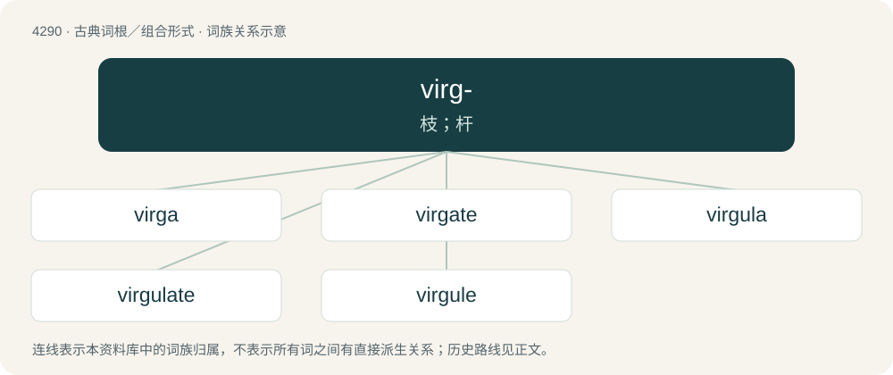

# 4292 · virg- — 枝；杆

[总目录](../00_总目录_按常用程度.md)

**类型**：古典词根／组合形式　｜　**来源语言**：拉丁语

## 核心含义与来源

- 核心含义：枝；杆
- 英文含义：rod, twig
- 词形：virg-

**来源词形**：virga

## 词族图

## 单词速览（常用到不常用）

| 单词 | 音标 | 释义 |
|---|---|---|
| [virga](#w-1) | 英 /ˈvɜːɡə/ | n. \[用作单或复\]\[气\]雨幡 |
| [virgate](#w-2) | 英 /ˈvɜːɡət/；美 /vɜɹˈɡeɪt/ | a. 棒状的, 多直细枝的 |
| [virgula](#w-3) | 英 /ˈvəːɡjʊlə/；美 /ˈvəɹɡjʊlə/ | 【英文】The spines of a ray. |
| [virgulate](#w-4) | /ˈvəːgjulit/ | a. 棒状的 |
| [virgule](#w-5) | 英 /ˈvɜː.ɡjuːl/；美 /ˈvɝ.ɡjul/ | n. 斜线 |

## 逐词详解

### 1. virga

**词性**：名词　｜　**音标**：英 /ˈvɜːɡə/

**中文释义**：n. \[用作单或复\]\[气\]雨幡

**英文义项**：A type of note used in plainsong notation, having a tail and representing a single tone. / A streak of rain or snow that is dissipated in falling and does not reach the ground, commonly appearing descending from a cloud layer.

**词源与演化**：

Borrowed from Latin virga (“rod”). Doublet of verge.

### 2. virgate

**词性**：名词　｜　**音标**：英 /ˈvɜːɡət/；美 /vɜɹˈɡeɪt/

**中文释义**：a. 棒状的, 多直细枝的

**英文义项**：The yardland: an obsolete English land measure usually comprising ¹⁄₄ of a hide and notionally equal to 30 acres.

**词源与演化**：

Borrowed from Latin virgāta, "yard" compared to "virga" as a measuring rod. Doublet of vergée.

### 3. virgula

**词性**：名词　｜　**音标**：英 /ˈvəːɡjʊlə/；美 /ˈvəɹɡjʊlə/

**英文义项**：The spines of a ray. / The sicula of a graptolite.

**词源与演化**：

From Latin virgula (“twig; wand; scratch comma”), from virga (“branch; rod”) + -ulus (“-ule: forming diminutives”). As a dowsing rod, via virgula divina or divinatoria. Doublet of virgule.

### 4. virgulate

**词性**：形容词　｜　**音标**：/ˈvəːgjulit/

**中文释义**：a. 棒状的

**英文义项**：Shaped like a little twig or rod.

### 5. virgule

**词性**：名词　｜　**音标**：英 /ˈvɜː.ɡjuːl/；美 /ˈvɝ.ɡjul/

**中文释义**：n. 斜线

**英文义项**：A medieval punctuation mark similar to the slash ⟨/⟩ or pipe ⟨\|⟩ and used as a scratch comma and caesura mark. / A slash, ⟨/⟩ or ⟨／⟩.

**词源与演化**：

Borrowed from Middle French virgule, from Latin virgula (“twig; scratch comma”), from virga (“rod, branch”) + -ulus (diminutive suffix). Doublet of virgula.

## 其他候选词

- virgularian
