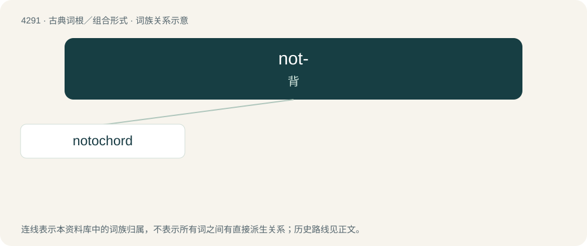

# 4293 · not- — 背

[总目录](../00_总目录_按常用程度.md)

**类型**：古典词根／组合形式　｜　**来源语言**：古希腊语

## 核心含义与来源

- 核心含义：背
- 英文含义：back
- 词形：not-

**来源词形**：νῶτον (nôton), νῶτος, νωτιαῖος

## 词族图

## 单词速览（常用到不常用）

| 单词 | 音标 | 释义 |
|---|---|---|
| [notochord](#w-1) | /ˈnəutəkɒːd/ | n. 脊索；\[医\] 脊索 |

## 逐词详解

### 1. notochord

**词性**：名词　｜　**音标**：/ˈnəutəkɒːd/

**中文释义**：n. 脊索；\[医\] 脊索

**英文义项**：A flexible rodlike structure that forms the main support of the body in the lowest chordates; a primitive spine. / A similar structure found in the embryos of vertebrates from which the spine develops.

**构词拆分**：From noto- + chord.

**词源与演化**：

From noto- + chord.
