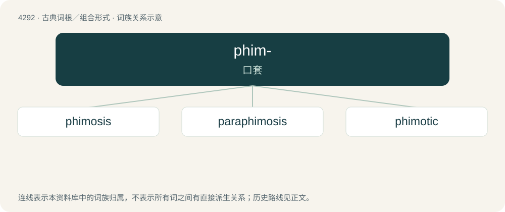

# 4294 · phim- — 口套

[总目录](../00_总目录_按常用程度.md)

**类型**：古典词根／组合形式　｜　**来源语言**：古希腊语

## 核心含义与来源

- 核心含义：口套
- 英文含义：muzzle
- 词形：phim-

**来源词形**：φῑμός (phīmós), φιμοῦν (phimoûn), φιμωτικός, φίμωσις (phímōsis)

## 词族图

## 单词速览（常用到不常用）

| 单词 | 音标 | 释义 |
|---|---|---|
| [phimosis](#w-1) | 英 /fʌɪˈməʊ.sɪs/；美 /faɪˈmoʊ.sɪs/ | n. \[医\]包茎, 包皮过长 |
| [paraphimosis](#w-2) | /,pærəfaiˈməusis/ | \[医\]轻度包茎, 眼睑收缩 |
| [phimotic](#w-3) |  | \[医\] 包茎的 |

## 逐词详解

### 1. phimosis

**词性**：名词　｜　**音标**：英 /fʌɪˈməʊ.sɪs/；美 /faɪˈmoʊ.sɪs/

**中文释义**：n. \[医\]包茎, 包皮过长

**英文义项**：A contraction of the foreskin (either as a stage of development or a pathological condition), which prevents it from being retracted.

**词源与演化**：

From Ancient Greek φίμωσις (phímōsis, “muzzling; contraction of the prepuce”), from φῑμόω (phīmóō, “to muzzle”) + -σις (-sis, nominal suffix).

### 2. paraphimosis

**词性**：名词　｜　**音标**：/,pærəfaiˈməusis/

**中文释义**：\[医\]轻度包茎, 眼睑收缩

**英文义项**：A medical condition where the foreskin becomes trapped behind the glans.

**构词拆分**：para- + phimosis

**词源与演化**：

From para- + phimosis.

### 3. phimotic

**词性**：形容词

**中文释义**：\[医\] 包茎的

**英文义项**：Pertaining to, or afflicted with, phimosis.
