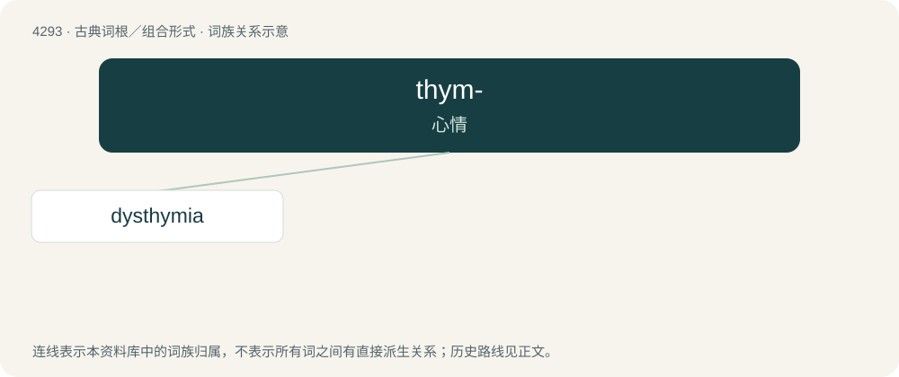

# 4295 · thym- — 心情

[总目录](../00_总目录_按常用程度.md)

**类型**：古典词根／组合形式　｜　**来源语言**：古希腊语

## 核心含义与来源

- 核心含义：心情
- 英文含义：mood
- 词形：thym-

**来源词形**：θυμός (thumós)

## 词族图

## 单词速览（常用到不常用）

| 单词 | 音标 | 释义 |
|---|---|---|
| [dysthymia](#w-1) | /disˈθaimiə/ | \[医\] 胸腺机能障碍, 心境恶劣 |

## 逐词详解

### 1. dysthymia

**词性**：名词　｜　**音标**：/disˈθaimiə/

**中文释义**：\[医\] 胸腺机能障碍, 心境恶劣

**英文义项**：A tendency to be depressed, without hope. / A form of clinical depression, characterized by low-grade depression which lasts at least two years.

**构词拆分**：dys- + -thymia

**词源与演化**：

From dys- + -thymia. From Ancient Greek δυσθυμία (dusthumía, “despondency, despair; ill-temper”), from δυσ- (dus-, “bad”) + θυμός (thumós, “soul, spirit”).

**例句**：

> I thought she had just been in a bad mood for thirty years, but the doctor called it dysthymia.

该用例对应义项：mild chronic depression
