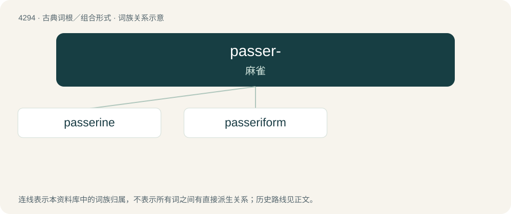

# 4296 · passer- — 麻雀

[总目录](../00_总目录_按常用程度.md)

**类型**：古典词根／组合形式　｜　**来源语言**：拉丁语

## 核心含义与来源

- 核心含义：麻雀
- 英文含义：sparrow
- 词形：passer-

**来源词形**：passer

## 词族图

## 单词速览（常用到不常用）

| 单词 | 音标 | 释义 |
|---|---|---|
| [passerine](#w-1) | 英 /ˈpæsəɹaɪn/；美 /ˈpæsəˌɹaɪn/ | a. 雀形目的；n. 雀形目鸟 |
| [passeriform](#w-2) | /ˈpæsərifɔːm,pəˈse-/ | a. \[鸟\]雀形目的 |

## 逐词详解

### 1. passerine

**词性**：形容词　｜　**音标**：英 /ˈpæsəɹaɪn/；美 /ˈpæsəˌɹaɪn/

**中文释义**：a. 雀形目的；n. 雀形目鸟

**英文义项**：Of or relating to the Passeriformes order of perching birds, which are generally anisodactyl, having three toes pointing forward and one back, which facilitates perching. / approximately the size of a sparrow.

**词源与演化**：

Adjective sense 1 is borrowed from New Latin Passer (“bird genus”) (from Latin passer (“sparrow”), ultimately from Proto-Indo-European \*peth₂- (“to spread out; to fly (in the sense of spreading out wings)”)) + English -ine (suffix meaning ‘of or pertaining to’). Adjective sense 2 is borrowed from New Latin passerinus (“bird species”) + English -ine. Passerinus is derived from Latin passerīnus (“of or fit for sparrows”), from passer (“sparrow”) (see above) + -īnus (suffix meaning ‘of or pertaining to’). The noun is borrowed from New Latin Passerinae (“former order of birds”), a calque of French passereaux, the plural of passereau (“sparrow; passerine (bird of the order Passeriformes)”), from Latin passer (“sparrow”) (see above) + -eau (suffix forming diminutive masculine nouns, specifically the names of young animals). Cognates \* French passerin (“sparrowlike”) (obsolete), Provençal French passerine (“passerine whitethroat, a bird from order Passeriformes”)

### 2. passeriform

**词性**：形容词　｜　**音标**：/ˈpæsərifɔːm,pəˈse-/

**中文释义**：a. \[鸟\]雀形目的

**英文义项**：Of or pertaining to a sparrow; sparrow-like; bird-like.

**词源与演化**：

From Latin passer (“sparrow”), + -iform. Borrowed from translingual Passeriformes in the taxonomic sense.
