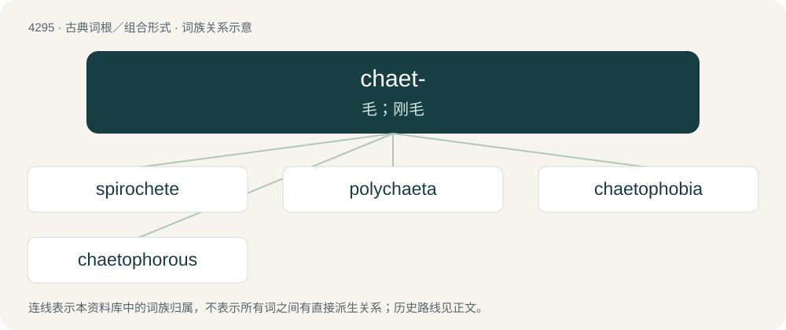

# 4297 · chaet- — 毛；刚毛

[总目录](../00_总目录_按常用程度.md)

**类型**：古典词根／组合形式　｜　**来源语言**：古希腊语

## 核心含义与来源

- 核心含义：毛；刚毛
- 英文含义：hair, bristle, or seta
- 词形：chaet-

**来源词形**：χαίτη (khaítē) "long hair"

## 词族图

## 单词速览（常用到不常用）

| 单词 | 音标 | 释义 |
|---|---|---|
| [spirochete](#w-1) | 美 /ˈspaɪ.ɹəˌkit/ | \[医\] 螺旋体 |
| [polychaeta](#w-2) |  | 【英文】Any annelid worm of the class Polychaeta |
| [chaetophobia](#w-3) |  | 【英文】fear of hair and/or hairy people or animals |
| [chaetophorous](#w-4) | 英 /kiːˈtɒfəɹəs/ | 【英文】Having bristles. |

## 逐词详解

### 1. spirochete

**词性**：名词　｜　**音标**：美 /ˈspaɪ.ɹəˌkit/

**中文释义**：\[医\] 螺旋体

**英文义项**：Any of several coiled bacteria of the order Spirochaetales, most of which are pathogenic to both humans and other animals.

**词源与演化**：

From translingual Spirochaeta.

### 2. polychaeta

**词性**：名词

**英文义项**：Any annelid worm of the class Polychaeta

**词源与演化**：

From the class name.

### 3. chaetophobia

**词性**：名词

**英文义项**：fear of hair and/or hairy people or animals

**词源与演化**：

From Ancient Greek χαίτη (khaítē, “flowing hair”). By surface analysis, chaeto- + -phobia.

### 4. chaetophorous

**词性**：形容词　｜　**音标**：英 /kiːˈtɒfəɹəs/

**英文义项**：Having bristles.

**词源与演化**：

From Ancient Greek χαίτη (khaítē, “hair”) + -φόρος (-phóros, “bearing”). By surface analysis, chaeto- + -phor + -ous.

**例句**：

> Boars are chaetophorous animals.

该用例对应义项：Having bristles.

## 其他候选词

- Chaetomium
- Chaetomorpha
- Oligochaeta
- polychaete
- spirochaete
