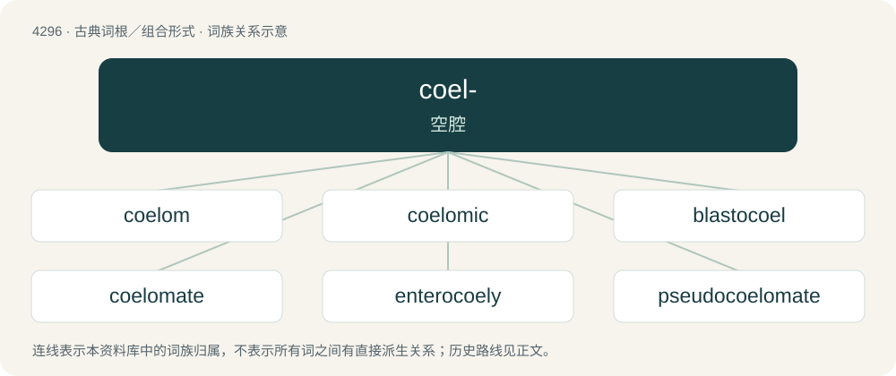

# 4299 · coel- — 空腔

[总目录](../00_总目录_按常用程度.md)

**类型**：古典词根／组合形式　｜　**来源语言**：古希腊语

## 核心含义与来源

- 核心含义：空腔
- 英文含义：hollow
- 词形：coel-

**来源词形**：κοῖλος (koîlos)

## 词族图

## 单词速览（常用到不常用）

| 单词 | 音标 | 释义 |
|---|---|---|
| [coelom](#w-1) | 英 /ˈsiːləm/ | n. 体腔；\[医\] 体腔 |
| [coelomic](#w-2) | /siːˈlɒmɪk/ | 体腔 |
| [blastocoel](#w-3) | /ˈblæstəjsiː l/ | n. \[生物\]囊胚腔, 分裂腔 |
| [coelomate](#w-4) | /ˈsiːləmeit/ | n. 有体腔之动物；a. 有体腔的 |
| [enterocoely](#w-5) |  | 【英文】The formation of the coelom in the development of an embryo |
| [pseudocoelomate](#w-6) | /,psjuːdəjˈsiːləmeit/ | a. & n.\[昆\]有假腔(的) |
| [sarcocele](#w-7) | /ˈsɑːkə,siːl/ | n. \[医\]睾丸肉样肿 |
| [schizocoelomate](#w-8) |  | 【英文】An animal that develops via schizocoely |
| [schizocoely](#w-9) |  | 【英文】The formation of a coelom from embryonic tissue |
| [spongocoel](#w-10) | /ˈspɔŋ^əjsiːl/ | n. \[动\]海绵腔 |

## 逐词详解

### 1. coelom

**词性**：名词　｜　**音标**：英 /ˈsiːləm/

**中文释义**：n. 体腔；\[医\] 体腔

**英文义项**：A fluid-filled cavity within the body of an animal. The digestive system is suspended within the cavity, which is lined by a tissue called the peritoneum.

**词源与演化**：

From international scientific vocabulary, from New Latin, from Ancient Greek κοίλωμα (koílōma, “hollow, cavity”). Cognate with coeliac.

### 2. coelomic

**词性**：形容词　｜　**音标**：/siːˈlɒmɪk/

**中文释义**：体腔

**英文义项**：Of, or relating to a coelom.

**构词拆分**：coelom + -ic

**词源与演化**：

From coelom + -ic.

### 3. blastocoel

**词性**：名词　｜　**音标**：/ˈblæstəjsiː l/

**中文释义**：n. \[生物\]囊胚腔, 分裂腔

**英文义项**：The fluid-filled cavity in a blastula.

**构词拆分**：From blasto- + -coel.

**词源与演化**：

From blasto- + -coel.

### 4. coelomate

**词性**：名词　｜　**音标**：/ˈsiːləmeit/

**中文释义**：n. 有体腔之动物；a. 有体腔的

**英文义项**：Any animal possessing a fluid-filled cavity within which the digestive system is suspended.

**构词拆分**：coelom + -ate (noun-forming suffix)

**词源与演化**：

From the substantivation of the adjective, equivalent to coelom + -ate (noun-forming suffix).

### 5. enterocoely

**词性**：名词

**英文义项**：The formation of the coelom in the development of an embryo / An embryonic coelom

### 6. pseudocoelomate

**词性**：形容词　｜　**音标**：/,psjuːdəjˈsiːləmeit/

**中文释义**：a. & n.\[昆\]有假腔(的)

**英文义项**：Of, pertaining to, or possessing a pseudocoel (pseudocoelom).

**构词拆分**：pseudocoelom + -ate

**词源与演化**：

From pseudocoelom + -ate (adjective-forming suffix).

### 7. sarcocele

**词性**：名词　｜　**音标**：/ˈsɑːkə,siːl/

**中文释义**：n. \[医\]睾丸肉样肿

**英文义项**：Any solid tumour of the testicle.

**构词拆分**：sarco- + -cele

**词源与演化**：

From sarco- + -cele.

### 8. schizocoelomate

**词性**：名词

**英文义项**：An animal that develops via schizocoely

### 9. schizocoely

**词性**：名词

**英文义项**：The formation of a coelom from embryonic tissue

### 10. spongocoel

**词性**：名词　｜　**音标**：/ˈspɔŋ^əjsiːl/

**中文释义**：n. \[动\]海绵腔

**英文义项**：The large central cavity of a sponge.

**构词拆分**：spongo- + -coel

**词源与演化**：

From spongo- + -coel.
