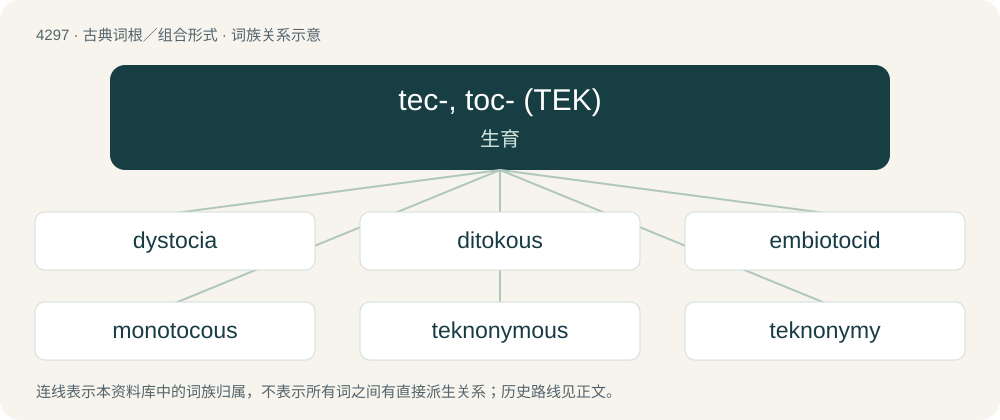

# 4300 · tec-, toc- (ΤΕΚ) — 生育

[总目录](../00_总目录_按常用程度.md)

**类型**：古典词根／组合形式　｜　**来源语言**：古希腊语

## 核心含义与来源

- 核心含义：生育
- 英文含义：childbirth
- 词形：tec-, toc-

**来源词形**：τίκτειν, τόκος (tókos)

## 词族图

## 单词速览（常用到不常用）

| 单词 | 音标 | 释义 |
|---|---|---|
| [dystocia](#w-1) | 英 /dɪsˈtəʊʃə/；美 /dɪsˈtoʊʃə/ | n. 难产；\[医\] 难产 |
| [ditokous](#w-2) |  | \[医\] 双胎分娩的, 双产的 |
| [embiotocid](#w-3) |  | 【英文】Any fish in the family Embiotocidae, the surfperches. |
| [monotocous](#w-4) | /məjˈnɔtəkəs/ | a. \[动\]一次产一卵的,(产)单胎的, 一胎产一仔的 |
| [teknonymous](#w-5) |  | 【英文】Relating to teknonymy. |
| [teknonymy](#w-6) | /tɛkˈnɒnɪmi/ | n. 亲从子名制,因子女得名制(即父或母以"…的父"或"…的母"命名) |
| [tokophobia](#w-7) | /ˌtəʊkəˈfəʊbi.ə/ | 【英文】A morbid fear of childbirth or pregnancy. |

## 逐词详解

### 1. dystocia

**词性**：名词　｜　**音标**：英 /dɪsˈtəʊʃə/；美 /dɪsˈtoʊʃə/

**中文释义**：n. 难产；\[医\] 难产

**英文义项**：A slow or difficult labour or delivery.

**词源与演化**：

From Ancient Greek δυστοκία (dustokía, “difficult childbirth”), from δυσ- (dus-, “bad”) + τόκος (tókos, “childbirth”), from τίκτω (tíktō, “I give birth”).

### 2. ditokous

**词性**：形容词

**中文释义**：\[医\] 双胎分娩的, 双产的

**英文义项**：Having two kinds of young, such as offspring from asexual reproduction versus those from sexual reproduction. / Producing only two offspring per reproductive cycle or gestation, such as two eggs in a clutch.

**词源与演化**：

Ancient Greek δίς (dís, “twice”) + τόκος (tókos, “a bringing forth, offspring”).

**例句**：

> Certain annelids are ditokous.

该用例对应义项：Having two kinds of young, such as offspring from asexual reproduction versus those from sexual reproduction.

### 3. embiotocid

**词性**：名词

**英文义项**：Any fish in the family Embiotocidae, the surfperches.

### 4. monotocous

**词性**：形容词　｜　**音标**：/məjˈnɔtəkəs/

**中文释义**：a. \[动\]一次产一卵的,(产)单胎的, 一胎产一仔的

**英文义项**：Bearing fruit only once; monocarpic. / Laying or producing a single egg or offspring; uniparous.

**词源与演化**：

From Ancient Greek μόνος (mónos) + τόκος (tókos).

### 5. teknonymous

**词性**：形容词

**英文义项**：Relating to teknonymy.

### 6. teknonymy

**词性**：名词　｜　**音标**：/tɛkˈnɒnɪmi/

**中文释义**：n. 亲从子名制,因子女得名制(即父或母以"…的父"或"…的母"命名)

**英文义项**：The cultural practice of referring to parents by the names of their children.

**构词拆分**：tecno- + -onymy

**词源与演化**：

From tecno- + -onymy.

### 7. tokophobia

**词性**：名词　｜　**音标**：/ˌtəʊkəˈfəʊbi.ə/

**英文义项**：A morbid fear of childbirth or pregnancy.

**词源与演化**：

From Ancient Greek τόκος (tókos, “birth”) + -φοβία (-phobía, “fear”).
