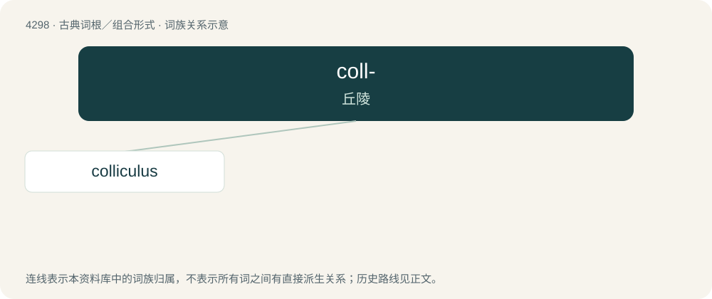

# 4301 · coll- — 丘陵

[总目录](../00_总目录_按常用程度.md)

**类型**：古典词根／组合形式　｜　**来源语言**：拉丁语

## 核心含义与来源

- 核心含义：丘陵
- 英文含义：hill
- 词形：coll-

**来源词形**：collis

## 词族图

## 单词速览（常用到不常用）

| 单词 | 音标 | 释义 |
|---|---|---|
| [colliculus](#w-1) | /kɔˈlikjuləs/ | \[解\]丘 |

## 逐词详解

### 1. colliculus

**词性**：名词　｜　**音标**：/kɔˈlikjuləs/

**中文释义**：\[解\]丘

**英文义项**：A small elevation.

**词源与演化**：

From Latin colliculus, diminutive of collis (“hill”).
