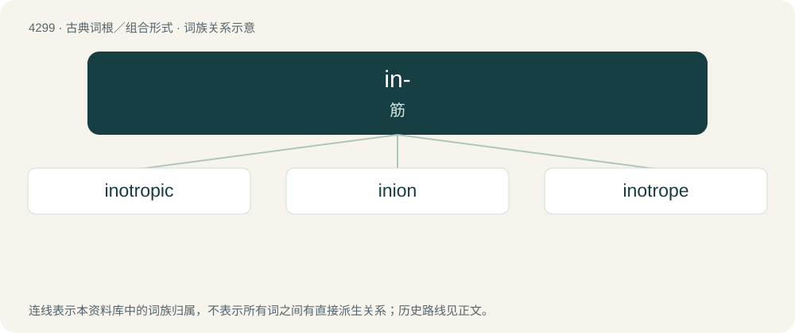

# 4302 · in- — 筋

[总目录](../00_总目录_按常用程度.md)

**类型**：古典词根／组合形式　｜　**来源语言**：古希腊语

## 核心含义与来源

- 核心含义：筋
- 英文含义：sinew
- 词形：in-

**来源词形**：ἴς, ἰνός (ís, inós), ἰνίον (iníon)

## 词族图

## 单词速览（常用到不常用）

| 单词 | 音标 | 释义 |
|---|---|---|
| [inotropic](#w-1) | 英 /ˌɪn.əˈtɹəʊ.pɪk/；美 /ˌiː.nəˈtɹoʊ.pɪk/ | a. \[医\]影响肌肉收缩力的,变力的 |
| [inion](#w-2) | /ˈiniən/ | n. \[解\]枕骨隆突(脑后枕骨外的突出部分) |
| [inotrope](#w-3) |  | 【英文】Any inotropic drug |

## 逐词详解

### 1. inotropic

**词性**：形容词　｜　**音标**：英 /ˌɪn.əˈtɹəʊ.pɪk/；美 /ˌiː.nəˈtɹoʊ.pɪk/

**中文释义**：a. \[医\]影响肌肉收缩力的,变力的

**英文义项**：Increasing or decreasing the force of muscular contractions.

**构词拆分**：Ancient Greek ἴς (ís, “sinew, tendon; strength, force”) + -tropic (“affecting, changing”)

**词源与演化**：

From Ancient Greek ἴς (ís, “sinew, tendon; strength, force”) + -tropic (“affecting, changing”), from Ancient Greek τρόπος (trópos, “turn, direction, way”) + -ικός (-ikós, “-ic”, adjectival suffix).

### 2. inion

**词性**：名词　｜　**音标**：/ˈiniən/

**中文释义**：n. \[解\]枕骨隆突(脑后枕骨外的突出部分)

**英文义项**：A small protuberance on the external surface of the back of the skull near the neck; the external occipital protuberance.

**词源与演化**：

From Ancient Greek ἰνίον (iníon, “occipital bone; back of the head”). Compare -ion (“anthropometric landmark”).

### 3. inotrope

**词性**：名词

**英文义项**：Any inotropic drug
