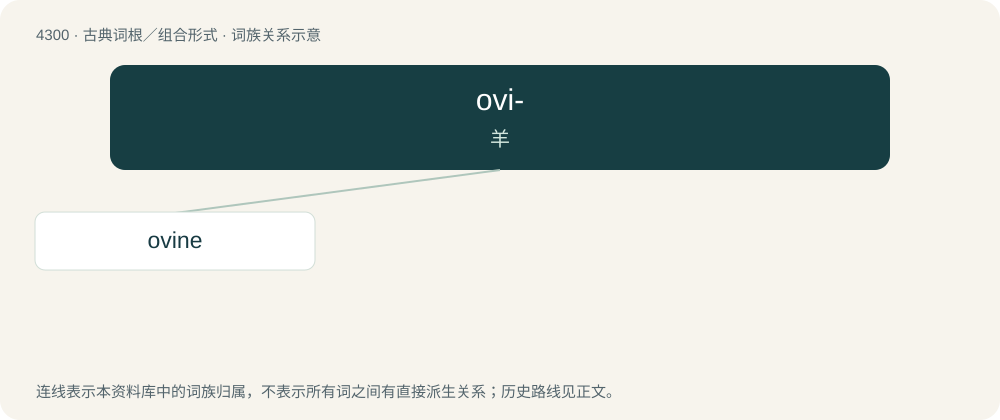

# 4303 · ovi- — 羊

[总目录](../00_总目录_按常用程度.md)

**类型**：古典词根／组合形式　｜　**来源语言**：拉丁语

## 核心含义与来源

- 核心含义：羊
- 英文含义：sheep
- 词形：ovi-

**来源词形**：ovis

## 词族图

## 单词速览（常用到不常用）

| 单词 | 音标 | 释义 |
|---|---|---|
| [ovine](#w-1) | 英 /ˈəʊvaɪn/；美 /ˈoʊˌvaɪn/ | a. 绵羊的；\[医\] 羊的 |

## 逐词详解

### 1. ovine

**词性**：形容词　｜　**音标**：英 /ˈəʊvaɪn/；美 /ˈoʊˌvaɪn/

**中文释义**：a. 绵羊的；\[医\] 羊的

**英文义项**：Of, being, pertaining to, or resembling a sheep; also, (not comparable) of an animal: from the genus Ovis. / Resembling a sheep in character; acquiescent, easily influenced, passive, or willing to follow a leader blindly.

**词源与演化**：

The adjective is borrowed from Late Latin ovīnus (“ovine”) + English -ine (suffix with the sense ‘of or relating to’ forming adjectives). Ovīnus is derived from Latin ovis (“sheep”) (ultimately from Proto-Indo-European \*h₂ówis (“sheep”), possibly from \*h₂ew- (“to clothe oneself, dress; to be dressed”) in the sense of something that provides woollen clothing) + -īnus (suffix with the sense ‘of or relating to’ forming adjectives). By surface analysis, ove- + -ine. The noun is derived from the adjective.

## 其他候选词

- ovile
