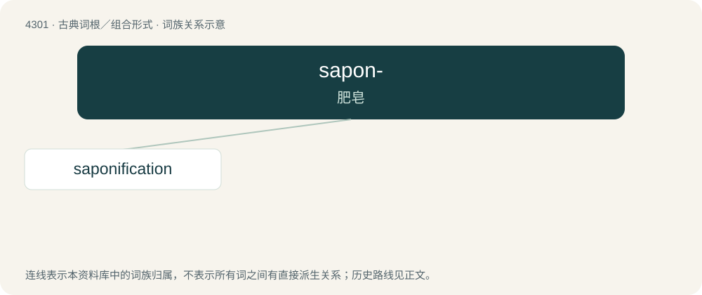

# 4304 · sapon- — 肥皂

[总目录](../00_总目录_按常用程度.md)

**类型**：古典词根／组合形式　｜　**来源语言**：拉丁语

## 核心含义与来源

- 核心含义：肥皂
- 英文含义：soap
- 词形：sapon-

**来源词形**：sapo, saponis

## 词族图

## 单词速览（常用到不常用）

| 单词 | 音标 | 释义 |
|---|---|---|
| [saponification](#w-1) | /sə.pɒnifiˈkeiʃən/ | n. 皂化；\[化\] 皂化 |

## 逐词详解

### 1. saponification

**词性**：名词　｜　**音标**：/sə.pɒnifiˈkeiʃən/

**中文释义**：n. 皂化；\[化\] 皂化

**英文义项**：The hydrolysis of an ester under basic conditions to form an alcohol and the salt of the acid. / The reaction of a metallic alkali (base) with a fat or oil to form soap.

**词源与演化**：

From French saponification, from saponifier (“saponify”).
