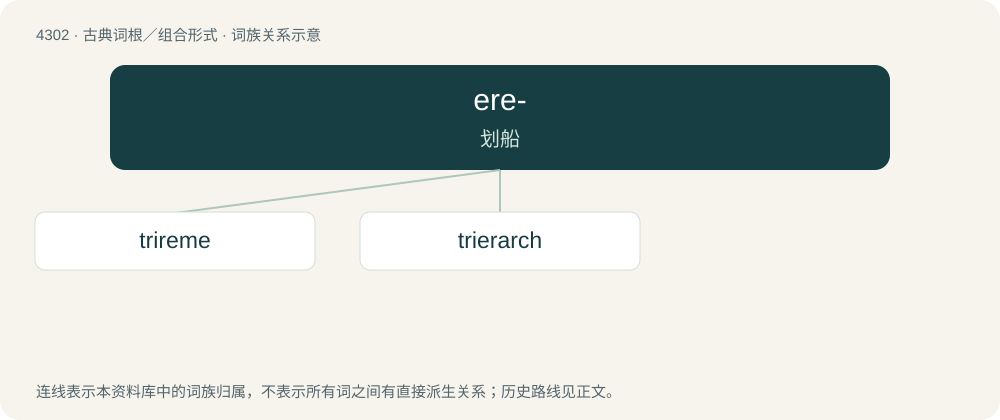

# 4305 · ere- — 划船

[总目录](../00_总目录_按常用程度.md)

**类型**：古典词根／组合形式　｜　**来源语言**：古希腊语

## 核心含义与来源

- 核心含义：划船
- 英文含义：row
- 词形：ere-

**来源词形**：ἐρέσσειν (eréssein), ἐρέτης (erétēs) "rower", ἐρετμόν (eretmón), εἰρεσία

## 词族图

## 单词速览（常用到不常用）

| 单词 | 音标 | 释义 |
|---|---|---|
| [trireme](#w-1) | /ˈtɹaɪ.ɹiːm/ | n. 三列桨船 |
| [trierarch](#w-2) | /ˈtrai,rɑːk/ | (古希腊)三层桨(座)战船的司令官 |

## 逐词详解

### 1. trireme

**词性**：名词　｜　**音标**：/ˈtɹaɪ.ɹiːm/

**中文释义**：n. 三列桨船

**英文义项**：A galley with three banks of oars, one above the other, used mainly as a warship.

**词源与演化**：

From Latin trirēmis, from tri- + rēmus (“oar”).

### 2. trierarch

**词性**：名词　｜　**音标**：/ˈtrai,rɑːk/

**中文释义**：(古希腊)三层桨(座)战船的司令官

**英文义项**：The captain of a trireme.

**词源与演化**：

From Latin trierarchus.

## 其他候选词

- hyperetes
