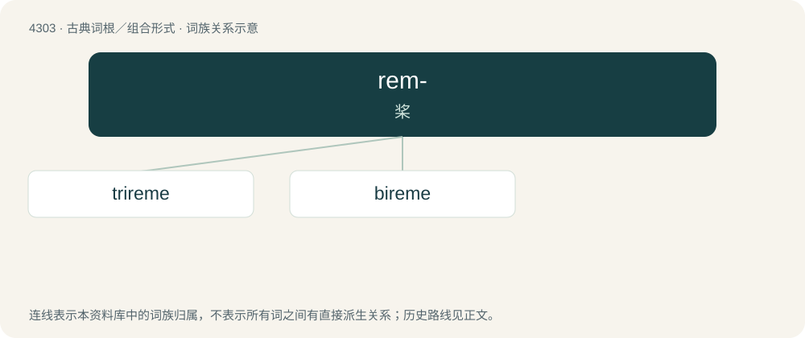

# 4306 · rem- — 桨

[总目录](../00_总目录_按常用程度.md)

**类型**：古典词根／组合形式　｜　**来源语言**：拉丁语

## 核心含义与来源

- 核心含义：桨
- 英文含义：oar
- 词形：rem-

**来源词形**：rēmus

## 词族图

## 单词速览（常用到不常用）

| 单词 | 音标 | 释义 |
|---|---|---|
| [trireme](#w-1) | /ˈtɹaɪ.ɹiːm/ | n. 三列桨船 |
| [bireme](#w-2) | /ˈbaɪˌriːm/ | n. 双排桨快艇(古地中海上一种海船) |

## 逐词详解

### 1. trireme

**词性**：名词　｜　**音标**：/ˈtɹaɪ.ɹiːm/

**中文释义**：n. 三列桨船

**英文义项**：A galley with three banks of oars, one above the other, used mainly as a warship.

**词源与演化**：

From Latin trirēmis, from tri- + rēmus (“oar”).

### 2. bireme

**词性**：名词　｜　**音标**：/ˈbaɪˌriːm/

**中文释义**：n. 双排桨快艇(古地中海上一种海船)

**英文义项**：An ancient galley having two banks of oars, one above the other.
