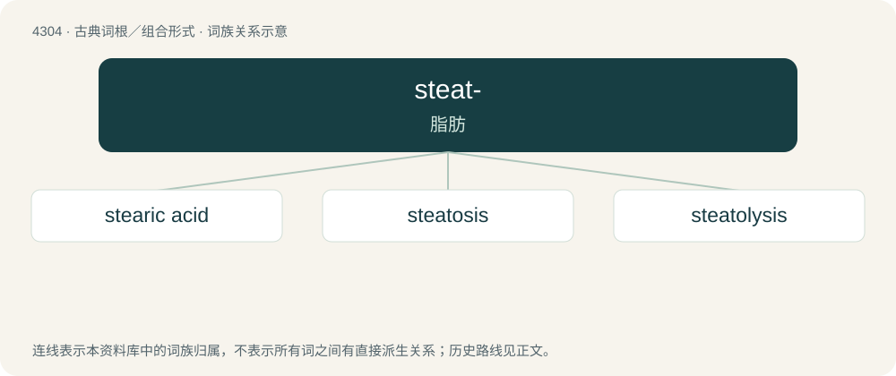

# 4307 · steat- — 脂肪

[总目录](../00_总目录_按常用程度.md)

**类型**：古典词根／组合形式　｜　**来源语言**：古希腊语

## 核心含义与来源

- 核心含义：脂肪
- 英文含义：fat, tallow
- 词形：steat-

**来源词形**：στέαρ, στέατος (stéar, stéatos)

## 词族图

## 单词速览（常用到不常用）

| 单词 | 音标 | 释义 |
|---|---|---|
| [stearic acid](#w-1) |  | \[化\] 硬脂酸; 十八酸; 十八烷酸；\[医\] 硬脂酸 |
| [steatosis](#w-2) | /stiːəˈtəusis/ | 脂肪变性 |
| [steatolysis](#w-3) | 英 /ˌstɪəˈtɒlɪsɪs/ | n. 脂肪分解；\[医\] 脂肪分解, 脂肪水解 |

## 逐词详解

### 1. stearic acid

**词性**：名词

**中文释义**：\[化\] 硬脂酸; 十八酸; 十八烷酸；\[医\] 硬脂酸

**英文义项**：octadecanoic acid; the most common saturated fatty acid; it is found in all animal and most vegetable oils and fats; it is used in the manufacture of soap etc.

### 2. steatosis

**词性**：名词　｜　**音标**：/stiːəˈtəusis/

**中文释义**：脂肪变性

**英文义项**：The abnormal retention of lipids by a cell or organ.

**构词拆分**：steato- + -osis

**词源与演化**：

From steato- + -osis.

### 3. steatolysis

**词性**：名词　｜　**音标**：英 /ˌstɪəˈtɒlɪsɪs/

**中文释义**：n. 脂肪分解；\[医\] 脂肪分解, 脂肪水解

**英文义项**：The digestion of fats, involving their emulsification followed by hydrolysis into fatty acids and glycerine. / The breakdown of fat.

**构词拆分**：steato- + -lysis

**词源与演化**：

From steato- + -lysis.

## 其他候选词

- steatolytic
