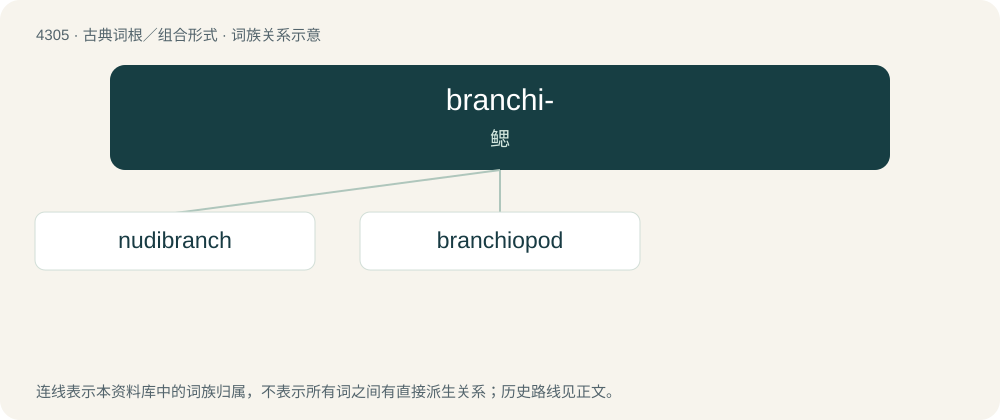

# 4308 · branchi- — 鳃

[总目录](../00_总目录_按常用程度.md)

**类型**：古典词根／组合形式　｜　**来源语言**：古希腊语

## 核心含义与来源

- 核心含义：鳃
- 英文含义：gill
- 词形：branchi-

**来源词形**：βράγχιον (bránkhion)

## 词族图

## 单词速览（常用到不常用）

| 单词 | 音标 | 释义 |
|---|---|---|
| [nudibranch](#w-1) | /ˈn(j)uːdɪˌbɹæŋk/ | n. \[动\] 裸鳃亚目动物 |
| [branchiopod](#w-2) | /ˈbræŋkiəpɔd/ | n. & adj.鳃足动物(的),叶足动物(的) |

## 逐词详解

### 1. nudibranch

**词性**：名词　｜　**音标**：/ˈn(j)uːdɪˌbɹæŋk/

**中文释义**：n. \[动\] 裸鳃亚目动物

**英文义项**：A sea slug belonging to the order Nudibranchia.

**词源与演化**：

Circa 19th century, borrowed from translingual Nudibranchia, from Latin nudus (“naked”) + branchia (“gills”).

**例句**：

> Elsewhere we watch large ocean predators and tiny denizens of the sea like the strangely alien nudibranch and Christmas tree worms.

### 2. branchiopod

**词性**：名词　｜　**音标**：/ˈbræŋkiəpɔd/

**中文释义**：n. & adj.鳃足动物(的),叶足动物(的)

**英文义项**：Any of the very many aquatic crustaceans of the class Branchiopoda, such as the fairy shrimps and water fleas.

**词源与演化**：

See Branchiopoda.

## 其他候选词

- branchiopneustic
