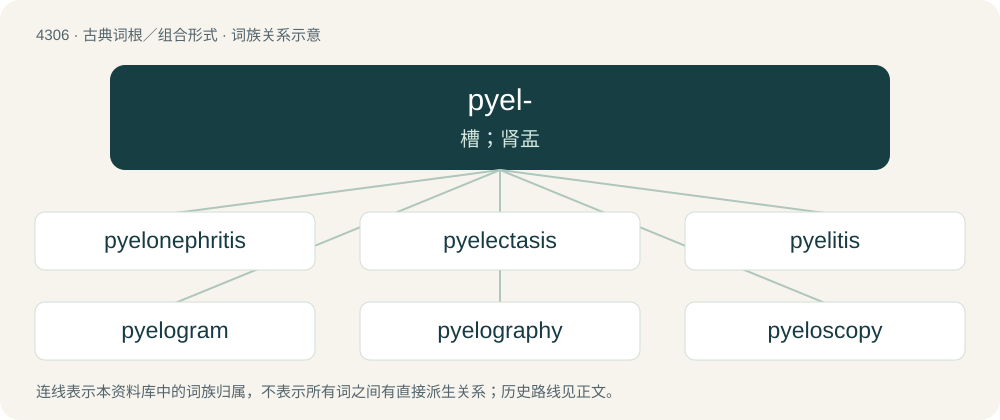

# 4309 · pyel- — 槽；肾盂

[总目录](../00_总目录_按常用程度.md)

**类型**：古典词根／组合形式　｜　**来源语言**：古希腊语

## 核心含义与来源

- 核心含义：槽；肾盂
- 英文含义：trough
- 词形：pyel-

**来源词形**：πύελος (púelos), πυελίς

## 词族图

## 单词速览（常用到不常用）

| 单词 | 音标 | 释义 |
|---|---|---|
| [pyelonephritis](#w-1) | /,paiələuniˈfraitis/ | n. \[医\]肾盂肾炎 |
| [pyelectasis](#w-2) |  | 【英文】A dilation of the renal pelvis. |
| [pyelitis](#w-3) | /.paiəˈlaitis/ | n. 肾盂炎；\[医\] 肾盂炎 |
| [pyelogram](#w-4) | /ˈpaiələ^ræm/ | n. \[医\]肾盂X线(照)片,肾盂造影照片 |
| [pyelography](#w-5) | /,paiəˈlɔ^rəfi/ | n. \[医\]肾盂造影术 |
| [pyeloscopy](#w-6) | /paiəˈlɔskəpi/ | n. \[医\]肾盂X线透视检查 |

## 逐词详解

### 1. pyelonephritis

**词性**：名词　｜　**音标**：/,paiələuniˈfraitis/

**中文释义**：n. \[医\]肾盂肾炎

**英文义项**：An ascending urinary tract infection of the renal pelvis

**构词拆分**：pyelo- (“relating to the renal pelvis”) + nephritis

**词源与演化**：

From pyelo- (“relating to the renal pelvis”) + nephritis.

### 2. pyelectasis

**词性**：名词

**英文义项**：A dilation of the renal pelvis.

**词源与演化**：

By surface analysis, pyel- + ec- + tasis.

### 3. pyelitis

**词性**：名词　｜　**音标**：/.paiəˈlaitis/

**中文释义**：n. 肾盂炎；\[医\] 肾盂炎

**英文义项**：pyelonephritis

**词源与演化**：

From Ancient Greek πυέλος (puélos, “oblong trough”) + -itis, from Proto-Indo-European \*plu- (zero-grade form of \*plew-) + \*-elos. By surface analysis, pyel- + -itis.

### 4. pyelogram

**词性**：名词　｜　**音标**：/ˈpaiələ^ræm/

**中文释义**：n. \[医\]肾盂X线(照)片,肾盂造影照片

**英文义项**：An image produced by means of pyelography.

**构词拆分**：pyelo- + -gram

**词源与演化**：

From pyelo- + -gram.

### 5. pyelography

**词性**：名词　｜　**音标**：/,paiəˈlɔ^rəfi/

**中文释义**：n. \[医\]肾盂造影术

**英文义项**：radiography of the kidney, ureter and bladder following injection of a radiopaque substance

**构词拆分**：pyelo- + -graphy

**词源与演化**：

From pyelo- + -graphy.

### 6. pyeloscopy

**词性**：名词　｜　**音标**：/paiəˈlɔskəpi/

**中文释义**：n. \[医\]肾盂X线透视检查

**英文义项**：medical examination of the pyelum, or renal pelvis, allowing visualisation of the entire drainage system of the kidney

**构词拆分**：pyelo- + -scopy

**词源与演化**：

From pyelo- + -scopy.
