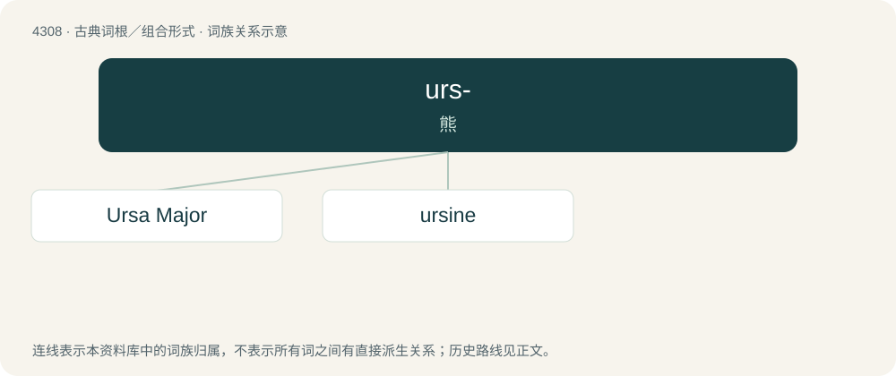

# 4310 · urs- — 熊

[总目录](../00_总目录_按常用程度.md)

**类型**：古典词根／组合形式　｜　**来源语言**：拉丁语

## 核心含义与来源

- 核心含义：熊
- 英文含义：bear
- 词形：urs-

**来源词形**：ursus

## 词族图

## 单词速览（常用到不常用）

| 单词 | 音标 | 释义 |
|---|---|---|
| [Ursa Major](#w-1) | 美 /ˌɝsə ˈmeɪdʒɚ/ | 大熊(星)座 |
| [ursine](#w-2) | 英 /ˈɜː.saɪn/；美 /ˈɝsaɪn/ | a. 熊的, 像熊的 |

## 逐词详解

### 1. Ursa Major

**词性**：专有名词　｜　**音标**：美 /ˌɝsə ˈmeɪdʒɚ/

**中文释义**：大熊(星)座

**英文义项**：A large circumpolar constellation of the northern sky, said to resemble a bear. It includes the familiar asterism the Big Dipper and the stars Mizar, Dubhe, and Alkaid.

**词源与演化**：

Borrowed from Latin Ursa maior (“(the) greater bear”).

### 2. ursine

**词性**：形容词　｜　**音标**：英 /ˈɜː.saɪn/；美 /ˈɝsaɪn/

**中文释义**：a. 熊的, 像熊的

**英文义项**：Of, pertaining to, or characteristic of bears. / Of, pertaining to, or characteristic of the bear subfamily Ursinae.

**词源与演化**：

Mid 16th century, from Latin ursīnus, adjectival form of ursus (“bear”) + -ine.

## 其他候选词

- Ursus
