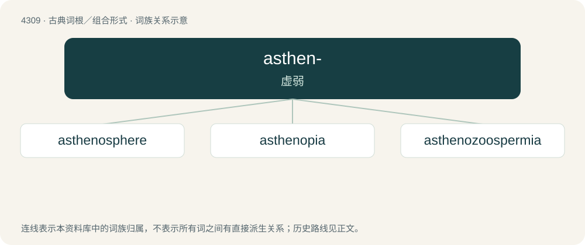

# 4311 · asthen- — 虚弱

[总目录](../00_总目录_按常用程度.md)

**类型**：古典词根／组合形式　｜　**来源语言**：古希腊语

## 核心含义与来源

- 核心含义：虚弱
- 英文含义：weak
- 词形：asthen-

**来源词形**：ἀσθενής (asthenḗs)

## 词族图

## 单词速览（常用到不常用）

| 单词 | 音标 | 释义 |
|---|---|---|
| [asthenosphere](#w-1) | 英 /asˈθɛnə(ʊ)sfɪə/ | n. 软流圈 |
| [asthenopia](#w-2) | /,æsθiˈnəupiə/ | n. \[医\]弱视的 |
| [asthenozoospermia](#w-3) |  | 【英文】Condition in which a large proportion of spermatozoa produced in an ejaculate possess poor motility. |

## 逐词详解

### 1. asthenosphere

**词性**：名词　｜　**音标**：英 /asˈθɛnə(ʊ)sfɪə/

**中文释义**：n. 软流圈

**英文义项**：A portion of the Earth's upper mantle, below the lithosphere.

**构词拆分**：astheno- + -sphere

**词源与演化**：

From astheno- + -sphere.

### 2. asthenopia

**词性**：名词　｜　**音标**：/,æsθiˈnəupiə/

**中文释义**：n. \[医\]弱视的

**英文义项**：An eye condition that manifests itself through nonspecific symptoms such as fatigue, red eyes, eyestrain, pain in or around the eyes, blurred vision, headache and occasional double vision.

**构词拆分**：astheno- + -opia

**词源与演化**：

From astheno- (“loss of strength”) + -opia (“relating to the eyes”).

### 3. asthenozoospermia

**词性**：名词

**英文义项**：Condition in which a large proportion of spermatozoa produced in an ejaculate possess poor motility.

**构词拆分**：astheno- + zoospermia

**词源与演化**：

From astheno- + zoospermia. By surface analysis, a- (“not”) + sthen- (“strength”) + -o- (“connecting vowel”) + zo- (“animal”) + -o- (“connecting vowel”) + sperm (“seed”) + -ia (“condition”).
