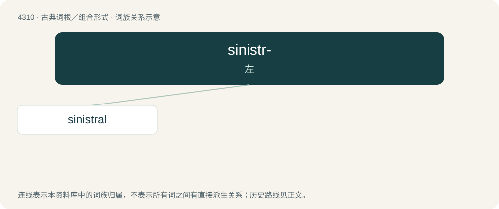

# 4312 · sinistr- — 左

[总目录](../00_总目录_按常用程度.md)

**类型**：古典词根／组合形式　｜　**来源语言**：拉丁语

## 核心含义与来源

- 核心含义：左
- 英文含义：left
- 词形：sinistr-

**来源词形**：sinister, sinistri

## 词族图

## 单词速览（常用到不常用）

| 单词 | 音标 | 释义 |
|---|---|---|
| [sinistral](#w-1) | /ˈsinistrəl/ | a. 左的, 使用左手的, 左旋的；\[医\] 左侧的; 左利的, 善用左侧器官的 |

## 逐词详解

### 1. sinistral

**词性**：形容词　｜　**音标**：/ˈsinistrəl/

**中文释义**：a. 左的, 使用左手的, 左旋的；\[医\] 左侧的; 左利的, 善用左侧器官的

**英文义项**：Of, facing, or on the left side. / Left-handed.

**例句**：

> A sinistral gastropod shell with the apex upward has its opening on the left when facing the observer.

该用例对应义项：of or on the left
