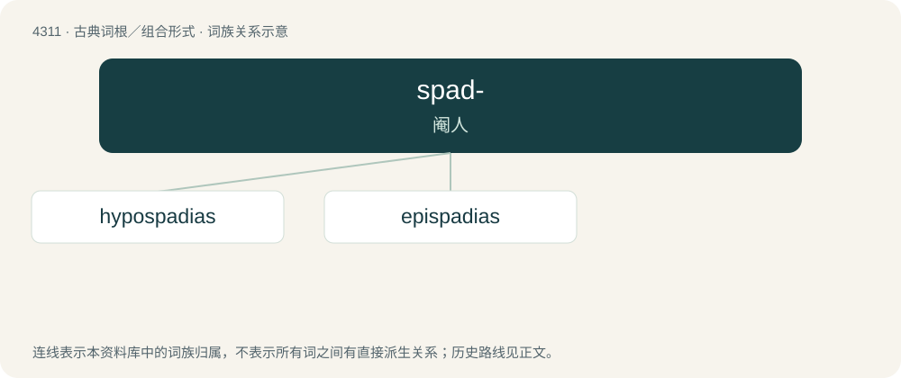

# 4313 · spad- — 阉人

[总目录](../00_总目录_按常用程度.md)

**类型**：古典词根／组合形式　｜　**来源语言**：古希腊语

## 核心含义与来源

- 核心含义：阉人
- 英文含义：eunuch
- 词形：spad-

**来源词形**：σπάδος (spádos), σπάδων (spádōn), σπαδοειδής

## 词族图

## 单词速览（常用到不常用）

| 单词 | 音标 | 释义 |
|---|---|---|
| [hypospadias](#w-1) | 英 /ˌhʌɪ.pəʊˈspeɪ.di.əs/；美 /ˌhaɪ.pəˈspeɪ.di.əs/ | n. \[医\]尿道下裂 |
| [epispadias](#w-2) | 美 /ˌɛp.ɪˈspeɪ.di.əs/ | 尿道上裂 |

## 逐词详解

### 1. hypospadias

**词性**：名词　｜　**音标**：英 /ˌhʌɪ.pəʊˈspeɪ.di.əs/；美 /ˌhaɪ.pəˈspeɪ.di.əs/

**中文释义**：n. \[医\]尿道下裂

**英文义项**：A congenital condition in males in which the opening of the urethra is on the underside of the penis.

**词源与演化**：

From Ancient Greek ὑποσπαδίᾱς (hupospadíās, “one who has the orifice of the urethra too low”).

### 2. epispadias

**词性**：名词　｜　**音标**：美 /ˌɛp.ɪˈspeɪ.di.əs/

**中文释义**：尿道上裂

**英文义项**：A deformity in which the urethra opens upon the top of the penis, instead of at its extremity.

**词源与演化**：

From Ancient Greek ἐπισπαδίας (epispadías), from ἐπι- (epi-, “upon, epi-”) + σπάω (spáō, “to draw”) + -ίᾱς (-íās, nominal suffix), related to σπάδων (spádōn, “eunuch”).
