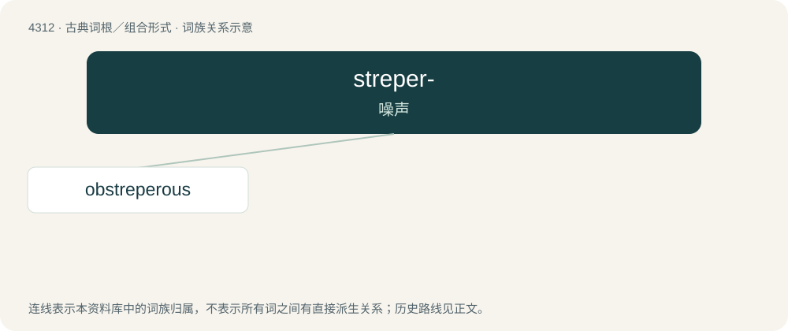

# 4314 · streper- — 噪声

[总目录](../00_总目录_按常用程度.md)

**类型**：古典词根／组合形式　｜　**来源语言**：拉丁语

## 核心含义与来源

- 核心含义：噪声
- 英文含义：noise
- 词形：streper-

**来源词形**：strepere

## 词族图

## 单词速览（常用到不常用）

| 单词 | 音标 | 释义 |
|---|---|---|
| [obstreperous](#w-1) | 英 /əbˈstɹɛp.əɹ.əs/；美 /əbˈstɹɛpəɹəs/ | a. 吵闹的, 喧嚣的, 骚乱的, 不守秩序的 |

## 逐词详解

### 1. obstreperous

**词性**：形容词　｜　**音标**：英 /əbˈstɹɛp.əɹ.əs/；美 /əbˈstɹɛpəɹəs/

**中文释义**：a. 吵闹的, 喧嚣的, 骚乱的, 不守秩序的

**英文义项**：Attended by, or making, a loud and tumultuous noise; boisterous. / Stubbornly defiant; disobedient; resistant to authority or control (whether in a noisy manner or not).

**词源与演化**：

Borrowed from Latin obstreperus, first attested circa 17th c. Compare obstropulous.
