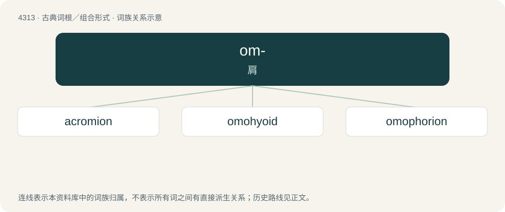

# 4315 · om- — 肩

[总目录](../00_总目录_按常用程度.md)

**类型**：古典词根／组合形式　｜　**来源语言**：古希腊语

## 核心含义与来源

- 核心含义：肩
- 英文含义：shoulder
- 词形：om-

**来源词形**：ὦμος (ômos), ὠμία (ōmía)

## 词族图

## 单词速览（常用到不常用）

| 单词 | 音标 | 释义 |
|---|---|---|
| [acromion](#w-1) | 美 /əˈkɹoʊ.mi.ən/ | n. \[解剖\]肩峰 |
| [omohyoid](#w-2) | 英 /əʊ.məʊˈhʌɪ.ɔɪd/；美 /ˌoʊ.moʊˈhaɪˌɔɪd/ | \[医\] 肩胛舌骨的 |
| [omophorion](#w-3) |  | 【英文】A band of brocade originally of wool decorated with crosses and worn on the neck and around the shoulders as the distinguishing vestment of a bishop and the symbol of his spiritual and ecclesiastical authority in the |

## 逐词详解

### 1. acromion

**词性**：名词　｜　**音标**：美 /əˈkɹoʊ.mi.ən/

**中文释义**：n. \[解剖\]肩峰

**英文义项**：The outermost point of the shoulder blade.

**词源与演化**：

From Ancient Greek ἀκρώμιον (akrṓmion), variant of ἀκρωμία (akrōmía, “acromion”), from ἄκρος (ákros, “summit”) + ὦμ- (ôm-, “shoulder”) + -ιον (-ion, “noun suffix”). Compare -ion, especially in acropodion.

### 2. omohyoid

**词性**：形容词　｜　**音标**：英 /əʊ.məʊˈhʌɪ.ɔɪd/；美 /ˌoʊ.moʊˈhaɪˌɔɪd/

**中文释义**：\[医\] 肩胛舌骨的

**英文义项**：Of or relating to the shoulder and the hyoid bone. / Of or relating to the omohyoid muscle.

**构词拆分**：Ancient Greek ὦμος (ômos, “shoulder”) + Latin hȳoīdēs (“U-shaped”)；omo- (“shoulder”) + hyoid

**词源与演化**：

Borrowing from New Latin ōmohȳoīdēs, from Ancient Greek ὦμος (ômos, “shoulder”) + Latin hȳoīdēs (“U-shaped”); equivalent to omo- (“shoulder”) + hyoid. Doublet of omohyoideus.

### 3. omophorion

**词性**：名词

**英文义项**：A band of brocade originally of wool decorated with crosses and worn on the neck and around the shoulders as the distinguishing vestment of a bishop and the symbol of his spiritual and ecclesiastical authority in the Eastern Christian liturgical tradition, equivalent to the Western archepiscopal pallium.

**词源与演化**：

From Byzantine Greek ὠμοφόριον (ōmophórion), from Ancient Greek ὦμος (ômos, “shoulder”) + φέρω (phérō, “carry”).
