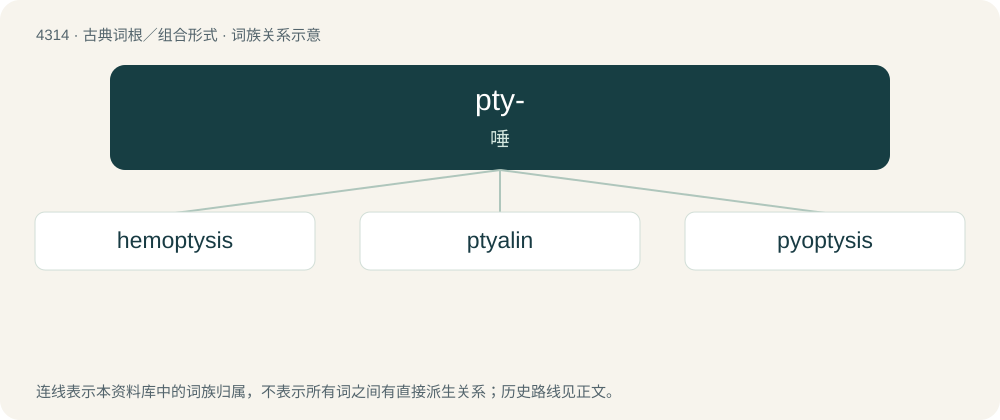

# 4316 · pty- — 唾

[总目录](../00_总目录_按常用程度.md)

**类型**：古典词根／组合形式　｜　**来源语言**：古希腊语

## 核心含义与来源

- 核心含义：唾
- 英文含义：spit
- 词形：pty-

**来源词形**：πτύειν, πτύον (ptúon), πτύσις (ptúsis), πτύαλον

## 词族图

## 单词速览（常用到不常用）

| 单词 | 音标 | 释义 |
|---|---|---|
| [hemoptysis](#w-1) | /hiˈmɔptisis/ | n. 咯血；\[医\] 咯血 |
| [ptyalin](#w-2) | /ˈtaiəlin/ | n. 唾液淀粉酶；\[化\] 唾液淀粉酶 |
| [pyoptysis](#w-3) | /paiˈɔptisis/ | 咯脓 |

## 逐词详解

### 1. hemoptysis

**词性**：名词　｜　**音标**：/hiˈmɔptisis/

**中文释义**：n. 咯血；\[医\] 咯血

**英文义项**：expectoration (coughing up) of blood from the respiratory system

**词源与演化**：

From hemo- + Ancient Greek πτύσις (ptúsis, “spitting”), from πτύω (ptúō, “to spit”).

### 2. ptyalin

**词性**：名词　｜　**音标**：/ˈtaiəlin/

**中文释义**：n. 唾液淀粉酶；\[化\] 唾液淀粉酶

**英文义项**：A form of amylase found in saliva that breaks down starch into maltose and dextrin.

**词源与演化**：

From Ancient Greek πτύαλον (ptúalon, “saliva”).

### 3. pyoptysis

**词性**：名词　｜　**音标**：/paiˈɔptisis/

**中文释义**：咯脓

**英文义项**：expectoration of pus

**词源与演化**：

From pyo- + Ancient Greek πτύω (ptúō, “spit”).
