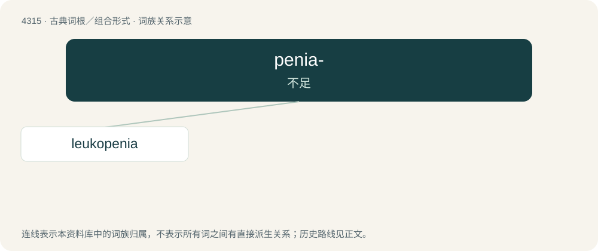

# 4317 · penia- — 不足

[总目录](../00_总目录_按常用程度.md)

**类型**：古典词根／组合形式　｜　**来源语言**：古希腊语

## 核心含义与来源

- 核心含义：不足
- 英文含义：deficiency
- 词形：penia-

**来源词形**：πενία (penía)

## 词族图

## 单词速览（常用到不常用）

| 单词 | 音标 | 释义 |
|---|---|---|
| [leukopenia](#w-1) | /.luːkəuˈpiːniə/ | n. 白血球减少症；\[医\] 白细胞减少 |

## 逐词详解

### 1. leukopenia

**词性**：名词　｜　**音标**：/.luːkəuˈpiːniə/

**中文释义**：n. 白血球减少症；\[医\] 白细胞减少

**英文义项**：An abnormally low count of leukocytes, or white blood cells, in the blood.

**构词拆分**：leuko- + -penia

**词源与演化**：

From leuko- + -penia.
