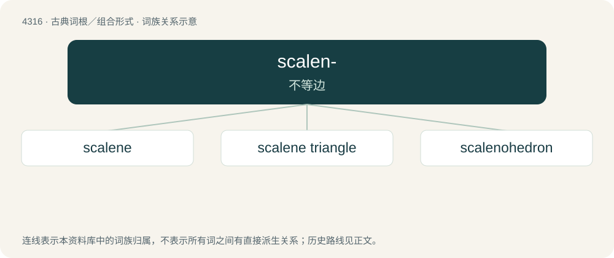

# 4318 · scalen- — 不等边

[总目录](../00_总目录_按常用程度.md)

**类型**：古典词根／组合形式　｜　**来源语言**：古希腊语

## 核心含义与来源

- 核心含义：不等边
- 英文含义：uneven
- 词形：scalen-

**来源词形**：σκαληνός (skalēnós)

## 词族图

## 单词速览（常用到不常用）

| 单词 | 音标 | 释义 |
|---|---|---|
| [scalene](#w-1) | 英 /ˈskeɪliːn/；美 /ˈskeɪlin/ | a. 不等边的, 倾轴的, 斜角肌的；n. 不等边三角形, 斜角肌 |
| [scalene triangle](#w-2) | /ˌskeɪliːn ˈtraɪæŋgl/ | 不等边三角形 |
| [scalenohedron](#w-3) | /skei,liːnəˈhedrən/ | 偏三角面体 |

## 逐词详解

### 1. scalene

**词性**：形容词　｜　**音标**：英 /ˈskeɪliːn/；美 /ˈskeɪlin/

**中文释义**：a. 不等边的, 倾轴的, 斜角肌的；n. 不等边三角形, 斜角肌

**英文义项**：Having sides all unequal in length. / Of or pertaining to the scalene muscle.

**词源与演化**：

Borrowed from Late Latin scalēnus (“of unequal sides”), from Ancient Greek σκᾰληνός (skălēnós, “uneven, unequal”).

**用法示例／搭配（非完整句）**：

> scalene triangle

该用例对应义项：Having sides all unequal in length.

### 2. scalene triangle

**词性**：名词　｜　**音标**：/ˌskeɪliːn ˈtraɪæŋgl/

**中文释义**：不等边三角形

**英文义项**：A triangle having each of its three sides of different lengths.

### 3. scalenohedron

**词性**：名词　｜　**音标**：/skei,liːnəˈhedrən/

**中文释义**：偏三角面体

**英文义项**：A polyhedron having twelve sides, each in the form of a scalene triangle, that is topologically equivalent to a hexagonal bipyramid and whose middle section can be said to inscribe a rhombohedron.

**构词拆分**：scalene + -o- + -hedron

**词源与演化**：

From scalene + -o- + -hedron.

## 其他候选词

- scalene muscles
