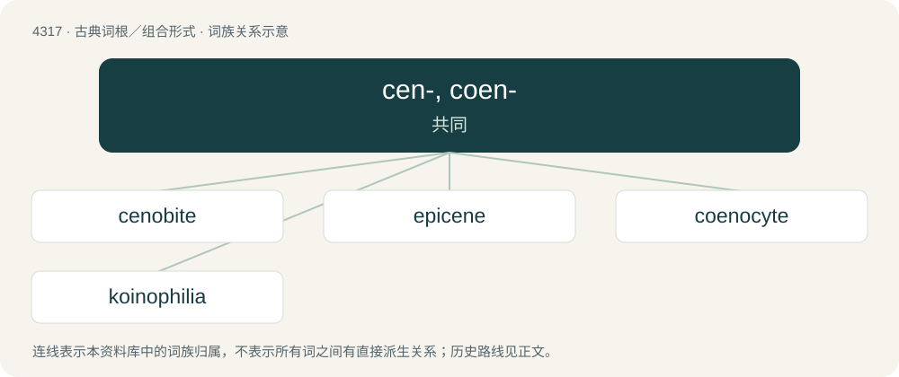

# 4319 · cen-, coen- — 共同

[总目录](../00_总目录_按常用程度.md)

**类型**：古典词根／组合形式　｜　**来源语言**：古希腊语

## 核心含义与来源

- 核心含义：共同
- 英文含义：common
- 词形：cen-, coen-

**来源词形**：κοινός (koinós)

## 词族图

## 单词速览（常用到不常用）

| 单词 | 音标 | 释义 |
|---|---|---|
| [cenobite](#w-1) | /ˈsɛn.əˌbaɪt/ | n. 住院修士 |
| [epicene](#w-2) | 英 /ˈɛp.ɪˌsiːn/；美 /ˈɛp.əˌsin/ | a. 通性的, 有两性特征的；n. 阴阳人 |
| [coenocyte](#w-3) | 英 /ˈsiː.nəʊˌseɪt/；美 /ˈsiː.noʊˌseɪt/ | n. 多核细胞, 合胞体, 多核体；\[医\] 多核体 |
| [koinophilia](#w-4) |  | 【英文】An evolutionary hypothesis proposing that, during sexual selection, animals preferentially seek mates with a minimum of unusual or mutant features. |

## 逐词详解

### 1. cenobite

**词性**：名词　｜　**音标**：/ˈsɛn.əˌbaɪt/

**中文释义**：n. 住院修士

**英文义项**：A new or recent member of a Greek monastic religious order; a caloyer. / A monk who lives in a religious community, rather than in solitude.

**词源与演化**：

From Old French cenobite or Ecclesiastical Latin coenobīta, from coenobium, from Ancient Greek κοινόβιον (koinóbion, “community life, convent”), from κοινός (koinós, “common”) + βίος (bíos, “life”).

### 2. epicene

**词性**：形容词　｜　**音标**：英 /ˈɛp.ɪˌsiːn/；美 /ˈɛp.əˌsin/

**中文释义**：a. 通性的, 有两性特征的；n. 阴阳人

**英文义项**：Of or relating to a class of Greek and Latin nouns that may refer to males or females but have a fixed grammatical gender (feminine, masculine, neuter, etc.). / Of or relating to nouns or pronouns in any language that have a single form for male and female referents.

**词源与演化**：

From Late Middle English epicene, epicen, epicin, epcyn, episcen, epycen, epycene, epycyn, ypsen (“(grammar) having only one form for masculine and feminine gender, common”), from Late Latin epicoenos, epicoenus (“of a noun: applicable to either males or females”), Latin epicoenon (“noun applicable to either males or females; grammatical gender of such nouns”), from Ancient Greek ἐπίκοινος (epíkoinos, “common to many people, things, etc.; promiscuous, sluttish”) (compare γένος ἐπίκοινον (génos epíkoinon, “common gender”)), from ἐπι- (epi-, prefix meaning ‘on, upon; on top of; all over’) + κοινός (koinós, “common; general, public”) (ultimately from Proto-Indo-European \*ḱóm (“beside, by, near, with”) + \*-yós (suffix forming adjectives from noun stems)).

### 3. coenocyte

**词性**：名词　｜　**音标**：英 /ˈsiː.nəʊˌseɪt/；美 /ˈsiː.noʊˌseɪt/

**中文释义**：n. 多核细胞, 合胞体, 多核体；\[医\] 多核体

**英文义项**：A cell with multiple nuclei, found in fungi, algae, protists and slime molds.

**词源与演化**：

From Ancient Greek κοινός (koinós, “common”) + κύτος (kútos, “box, i.e. cell”).

### 4. koinophilia

**词性**：名词

**英文义项**：An evolutionary hypothesis proposing that, during sexual selection, animals preferentially seek mates with a minimum of unusual or mutant features.

**词源与演化**：

Ancient Greek κοινός (koinós, “common, general”), and -philia.

## 其他候选词

- coenesthesia
- epicœne
- koinonos
