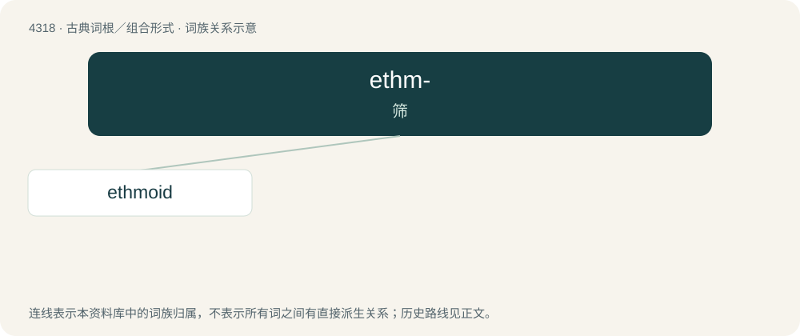

# 4320 · ethm- — 筛

[总目录](../00_总目录_按常用程度.md)

**类型**：古典词根／组合形式　｜　**来源语言**：古希腊语

## 核心含义与来源

- 核心含义：筛
- 英文含义：sieve, sift
- 词形：ethm-

**来源词形**：ἠθεῖν (ētheîn), ἠθμός (ēthmós); ἤθειν (ḗthein)

## 词族图

## 单词速览（常用到不常用）

| 单词 | 音标 | 释义 |
|---|---|---|
| [ethmoid](#w-1) | /ˈɛθ.mɔɪd/ | a. 筛骨的；n. 筛骨 |

## 逐词详解

### 1. ethmoid

**词性**：名词　｜　**音标**：/ˈɛθ.mɔɪd/

**中文释义**：a. 筛骨的；n. 筛骨

**英文义项**：A light spongy cubical bone at the root of the nose, forming much of the walls of the nasal cavity and part of those of the orbits and having many perforations through which the olfactory nerves pass to the nose.

**词源与演化**：

Borrowing from French ethmoïde, from Ancient Greek ἠθμοειδής (ēthmoeidḗs, “like a strainer, perforated”), from ἠθμός (ēthmós, “strainer, sieve”) + -ειδής (-eidḗs, “-form, -like”).
