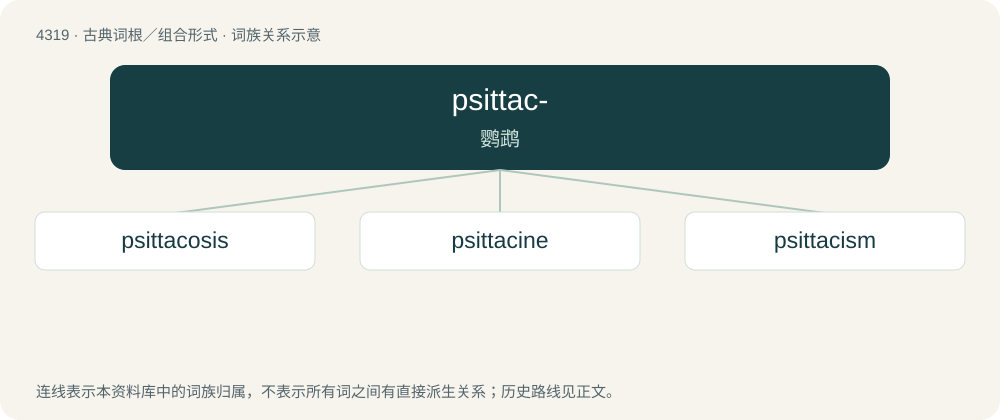

# 4321 · psittac- — 鹦鹉

[总目录](../00_总目录_按常用程度.md)

**类型**：古典词根／组合形式　｜　**来源语言**：古希腊语

## 核心含义与来源

- 核心含义：鹦鹉
- 英文含义：parrot
- 词形：psittac-

**来源词形**：ψιττακός, ψιττακοῦ (psittakós, psittakoû)

## 词族图

## 单词速览（常用到不常用）

| 单词 | 音标 | 释义 |
|---|---|---|
| [psittacosis](#w-1) | 美 /ˌsitəˈkoʊsɪs/ | n. 鹦鹉热；\[医\] 鹦鹉热 |
| [psittacine](#w-2) | /ˈpsitəsain, -sin/ | \[鸟\]Ⅰ adj.鹦鹉的, 鹦鹉般的 |
| [psittacism](#w-3) | /ˈpsitəsizəm/ | n. 鹦鹉学舌似的复述, 重复而无意义的言语 |

## 逐词详解

### 1. psittacosis

**词性**：名词　｜　**音标**：美 /ˌsitəˈkoʊsɪs/

**中文释义**：n. 鹦鹉热；\[医\] 鹦鹉热

**英文义项**：An infection by Chlamydia bacteria, caught from infected birds, and characterised by fever, pneumonia and headaches.

**词源与演化**：

From Latin psittacus (“parrot”) + -osis. By surface analysis, psittac- + -osis.

### 2. psittacine

**词性**：形容词　｜　**音标**：/ˈpsitəsain, -sin/

**中文释义**：\[鸟\]Ⅰ adj.鹦鹉的, 鹦鹉般的

**英文义项**：Of or pertaining to parrots.

**词源与演化**：

From Ancient Greek ψιττακός (psittakós) + -ine. By surface analysis, psittac- + -ine.

### 3. psittacism

**词性**：名词　｜　**音标**：/ˈpsitəsizəm/

**中文释义**：n. 鹦鹉学舌似的复述, 重复而无意义的言语

**英文义项**：Mechanical, repetitive words used without understanding or consideration.

**词源与演化**：

From Latin psittacus (“parrot”) + -ism. By surface analysis, psittac- + -ism.
