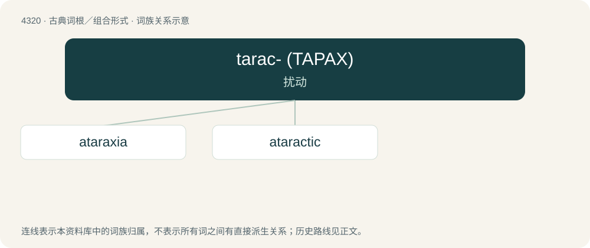

# 4322 · tarac- (ΤΑΡΑΧ) — 扰动

[总目录](../00_总目录_按常用程度.md)

**类型**：古典词根／组合形式　｜　**来源语言**：古希腊语

## 核心含义与来源

- 核心含义：扰动
- 英文含义：stir
- 词形：tarac-

**来源词形**：ταράσσειν (tarássein), ταρακτός, ταρακτικός, τάραγμα, θράσσω

## 词族图

## 单词速览（常用到不常用）

| 单词 | 音标 | 释义 |
|---|---|---|
| [ataraxia](#w-1) | 英 /ætəˈɹæksiə/ | n. 不激动, 无动于衷；\[医\] 心气和平, 心神安定 |
| [ataractic](#w-2) | /,ætəˈræktik/ | n. 镇静剂, 安定药；a. 镇静剂的 |

## 逐词详解

### 1. ataraxia

**词性**：名词　｜　**音标**：英 /ætəˈɹæksiə/

**中文释义**：n. 不激动, 无动于衷；\[医\] 心气和平, 心神安定

**英文义项**：Tranquility of mind; absence of mental disturbance.

**词源与演化**：

From Ancient Greek ἀταραξία (ataraxía), ἀ- (a-, negative prefix) + ταράσσω (tarássō, “trouble, disturb”). Doublet of ataraxy.

### 2. ataractic

**词性**：形容词　｜　**音标**：/,ætəˈræktik/

**中文释义**：n. 镇静剂, 安定药；a. 镇静剂的

**英文义项**：That has a tranquilizing effect.

**词源与演化**：

From Ancient Greek ἀτάρακτος (atáraktos, “intrepid”), from ταράσσω (tarássō).
