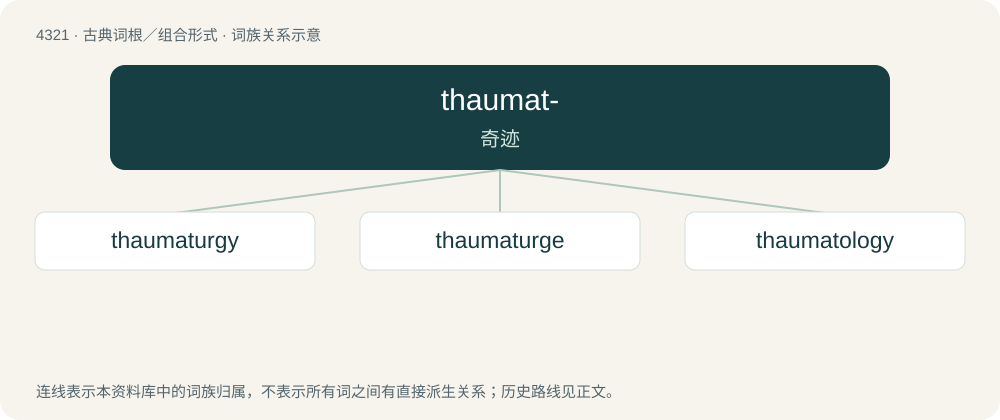

# 4323 · thaumat- — 奇迹

[总目录](../00_总目录_按常用程度.md)

**类型**：古典词根／组合形式　｜　**来源语言**：古希腊语

## 核心含义与来源

- 核心含义：奇迹
- 英文含义：miracle
- 词形：thaumat-

**来源词形**：θαυματ (thaumat)

## 词族图

## 单词速览（常用到不常用）

| 单词 | 音标 | 释义 |
|---|---|---|
| [thaumaturgy](#w-1) | 英 /ˈθɔːmətɜːd͡ʒi/；美 /ˈθɔməˌtɝd͡ʒi/ | n. 奇术, 魔术 |
| [thaumaturge](#w-2) | 美 /ˈθɔ.məˌtɚd͡ʒ/；/ˈθɔːməˌtɜː(ɹ)d͡ʒ/ | n. 行奇迹者, 术士 |
| [thaumatology](#w-3) | /,θɔːməˈtɔlədʒi/ | n. 奇迹学, 奇迹论 |

## 逐词详解

### 1. thaumaturgy

**词性**：名词　｜　**音标**：英 /ˈθɔːmətɜːd͡ʒi/；美 /ˈθɔməˌtɝd͡ʒi/

**中文释义**：n. 奇术, 魔术

**英文义项**：The working of miracles, wonderworking; magic, witchcraft, wizardry.

**词源与演化**：

From Ancient Greek θαυματουργία (thaumatourgía), from θαῦμα (thaûma, “miracle, wonder”) + ἔργον (érgon, “work”).

### 2. thaumaturge

**词性**：名词　｜　**音标**：美 /ˈθɔ.məˌtɚd͡ʒ/；/ˈθɔːməˌtɜː(ɹ)d͡ʒ/

**中文释义**：n. 行奇迹者, 术士

**英文义项**：A performer of thaumaturgy; a performer of miracles; a magician.

**词源与演化**：

From Medieval Latin thaumatūrgus, from Ancient Greek θαυματουργός (thaumatourgós), from θαύματο- (thaúmato-, “marvel”) + -ουργός (-ourgós, “worker, maker”). Doublet of thaumaturgus.

### 3. thaumatology

**词性**：名词　｜　**音标**：/,θɔːməˈtɔlədʒi/

**中文释义**：n. 奇迹学, 奇迹论

**英文义项**：The study of miracles.

**构词拆分**：thaumato- + -logy

**词源与演化**：

From thaumato- + -logy.
