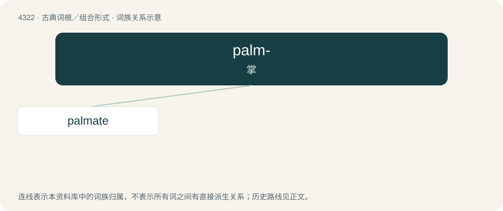

# 4324 · palm- — 掌

[总目录](../00_总目录_按常用程度.md)

**类型**：古典词根／组合形式　｜　**来源语言**：拉丁语

## 核心含义与来源

- 核心含义：掌
- 英文含义：palm
- 词形：palm-

**来源词形**：palma

## 词族图

## 单词速览（常用到不常用）

| 单词 | 音标 | 释义 |
|---|---|---|
| [palmate](#w-1) | /ˈpɑmeit/ | a. 手掌状的, 蹼足的；\[医\] 掌状的(叶脉) |

## 逐词详解

### 1. palmate

**词性**：形容词　｜　**音标**：/ˈpɑmeit/

**中文释义**：a. 手掌状的, 蹼足的；\[医\] 掌状的(叶脉)

**英文义项**：Having three or more lobes or veins arising from a common point. / Having more than three leaflets arising from a common point, often in the form of a fan.

**构词拆分**：palm + -ate (adjective-forming suffix)

**词源与演化**：

Learned borrowing from Latin palmātus (“hand-shaped, palm-leaf shaped”), from palma (“palm, palm-tree”). Equivalent to palm + -ate (adjective-forming suffix). Compare French palmé.

**例句**：

> Although palmate leaves are typical of most Western maples, a number of species have leaves without lobes.

该用例对应义项：Having three or more lobes or veins arising from a common point.
