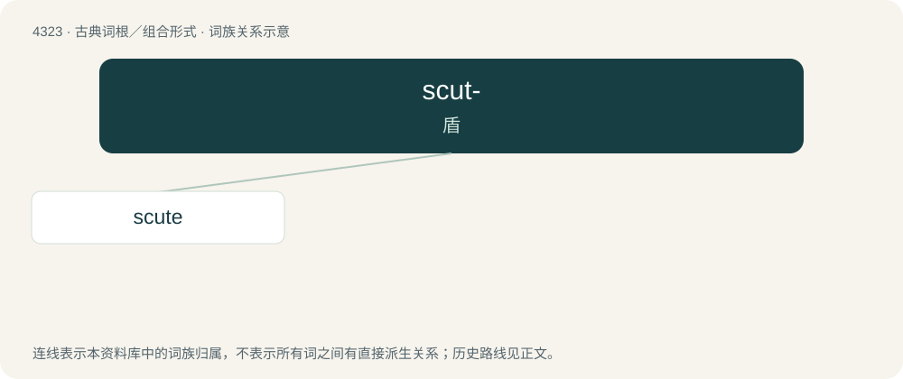

# 4325 · scut- — 盾

[总目录](../00_总目录_按常用程度.md)

**类型**：古典词根／组合形式　｜　**来源语言**：拉丁语

## 核心含义与来源

- 核心含义：盾
- 英文含义：shield
- 词形：scut-

**来源词形**：scutum

## 词族图

## 单词速览（常用到不常用）

| 单词 | 音标 | 释义 |
|---|---|---|
| [scute](#w-1) | /skjuːt/ | n. 鳞甲, 盾板；\[医\] 鳞, 鼓室盾板 |

## 逐词详解

### 1. scute

**词性**：名词　｜　**音标**：/skjuːt/

**中文释义**：n. 鳞甲, 盾板；\[医\] 鳞, 鼓室盾板

**英文义项**：A horny, chitinous, or bony external plate or scale, as on the shell of a turtle, the skin of crocodiles, or the feet and legs of birds. / A proneural gene, often associated with achaete, that is required for the formation of many larval and adult sense organs

**词源与演化**：

Borrowed from Latin scutum (“shield”). Compare scutum, escudo, scudo, and écu.
