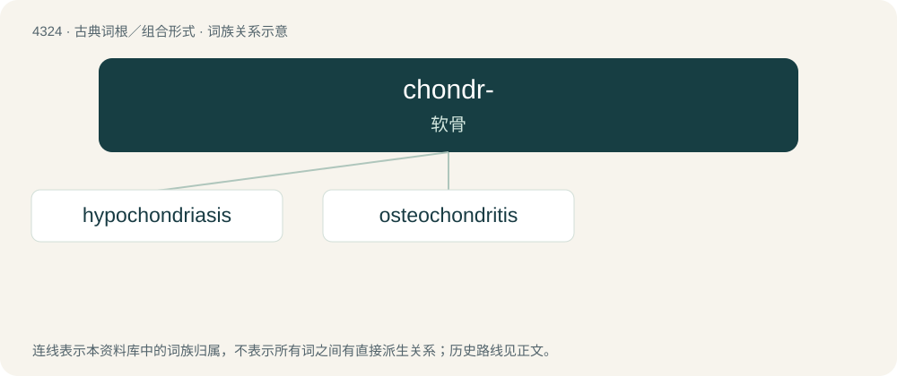

# 4326 · chondr- — 软骨

[总目录](../00_总目录_按常用程度.md)

**类型**：古典词根／组合形式　｜　**来源语言**：古希腊语

## 核心含义与来源

- 核心含义：软骨
- 英文含义：cartilage
- 词形：chondr-

**来源词形**：χόνδρος (khóndros)

## 词族图

## 单词速览（常用到不常用）

| 单词 | 音标 | 释义 |
|---|---|---|
| [hypochondriasis](#w-1) | 美 /ˌhaɪːpɔ.kanˈdɹaɪːəsɪs/ | n. 疑病(症状) |
| [osteochondritis](#w-2) | /,ɔstiə,kɔnˈdraitis/ | n. \[医\]骨软骨炎 |

## 逐词详解

### 1. hypochondriasis

**词性**：名词　｜　**音标**：美 /ˌhaɪːpɔ.kanˈdɹaɪːəsɪs/

**中文释义**：n. 疑病(症状)

**英文义项**：A mental disorder (in some classifications of such disorders, including ICD-11) characterized by a persistent preoccupation with having or developing a serious illness, despite the absence of significant physical symptoms or evidence of disease.

**词源与演化**：

From New Latin; by surface analysis, hypochondr(ium) + -iasis. See also hypochondria, hypochondrium, and Wikipedia at hypochondriasis § Etymology.

### 2. osteochondritis

**词性**：名词　｜　**音标**：/,ɔstiə,kɔnˈdraitis/

**中文释义**：n. \[医\]骨软骨炎

**英文义项**：inflammation of a bone and its cartilage

**构词拆分**：osteo- + chondritis

**词源与演化**：

From osteo- + chondritis.
