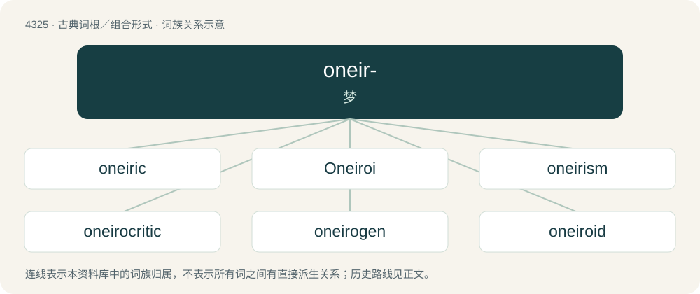

# 4327 · oneir- — 梦

[总目录](../00_总目录_按常用程度.md)

**类型**：古典词根／组合形式　｜　**来源语言**：古希腊语

## 核心含义与来源

- 核心含义：梦
- 英文含义：dream
- 词形：oneir-

**来源词形**：ὄνειρος (óneiros), ὀνειρώσσω, ὀνείρωξις (oneírōxis)

## 词族图

## 单词速览（常用到不常用）

| 单词 | 音标 | 释义 |
|---|---|---|
| [oneiric](#w-1) | 英 /əʊˈnaɪ.ɹɪk/；美 /oʊˈnaɪ.ɹɪk/ | a. 梦的, 梦一般的；\[医\] 梦的, 梦样的 |
| [Oneiroi](#w-2) |  | 【英文】The gods and personifications of dreams; the sons of Hypnos and Pasithea, or Nyx and Erebus. |
| [oneirism](#w-3) | 英 /ə(ʊ)ˈnʌɪɹɪzəm/ | \[医\] 梦样状态, 醒梦状态, 梦幻症 |
| [oneirocritic](#w-4) | 英 /əʊˌnaɪə.ɹəˈkɹɪt.ɪk/；美 /oʊˌnaɪ.ɹəˈkɹɪt.ɪk/ | a. 解梦的, 详梦术的 |
| [oneirogen](#w-5) |  | 【英文】Any drug, herb, etc. that produces or enhances a dream-like state of consciousness. |
| [oneiroid](#w-6) | /ə(ʊ)ˈnʌɪɹɔɪd/ | 【英文】Characterized by a dream-like or nightmare-like state, often as part of schizophrenia. |
| [oneirology](#w-7) | /,əjnaiəˈrɔlədʒi/ | n. 梦学,圆梦学 |
| [oneiromancy](#w-8) | 英 /əˈnaɪɹəˌmænsi/；美 /oʊˈnaɪɹoʊˌmæn(t)si/ | n. 解梦, 圆梦, 占梦 |
| [oneironaut](#w-9) | 英 /əʊˈnaɪɹənɔːt/；美 /oʊˈnaɪɹoʊnɔt/ | 【英文】A person who explores dream worlds, usually associated with lucid dreaming. |
| [oneironautics](#w-10) | 英 /əʊˌnaɪ.ɹəˈnɔːt.ɪks/；美 /oʊˌnaɪ.ɹoʊˈnɔt.ɪks/ | 【英文】Lucid dreaming, the ability to explore dreams. |
| [oneirophobia](#w-11) |  | 【英文】The fear of dreams. |
| [oneirophrenia](#w-12) |  | \[医\] 梦呓性精神病, 梦状精神分裂症 |
| [oneiroscopy](#w-13) |  | \[医\] 解梦诊断法 |

## 逐词详解

### 1. oneiric

**词性**：形容词　｜　**音标**：英 /əʊˈnaɪ.ɹɪk/；美 /oʊˈnaɪ.ɹɪk/

**中文释义**：a. 梦的, 梦一般的；\[医\] 梦的, 梦样的

**英文义项**：Of or pertaining to dreams. / Resembling a dream; dreamlike.

**构词拆分**：oneir- + -ic

**词源与演化**：

From oneir- + -ic, ultimately from Ancient Greek ὀνείρειος (oneíreios).

**例句**：

> I learned the word "oneiric" a few days ago.

### 2. Oneiroi

**词性**：专有名词

**英文义项**：The gods and personifications of dreams; the sons of Hypnos and Pasithea, or Nyx and Erebus.

**词源与演化**：

From the Ancient Greek Ὄνειροι (Óneiroi, “Dreams”).

### 3. oneirism

**词性**：名词　｜　**音标**：英 /ə(ʊ)ˈnʌɪɹɪzəm/

**中文释义**：\[医\] 梦样状态, 醒梦状态, 梦幻症

**英文义项**：Dream-like experiences or qualities; dreaminess. / A state of abnormal consciousness in which dream-like experiences and hallucinations happen while awake.

**构词拆分**：oneir- + -ism

**词源与演化**：

From oneir- + -ism.

### 4. oneirocritic

**词性**：名词　｜　**音标**：英 /əʊˌnaɪə.ɹəˈkɹɪt.ɪk/；美 /oʊˌnaɪ.ɹəˈkɹɪt.ɪk/

**中文释义**：a. 解梦的, 详梦术的

**英文义项**：An interpreter of dreams.

**词源与演化**：

From Ancient Greek ὀνειροκριτικός (oneirokritikós, “fit for interpreting dreams”), from ὄνειρος (óneiros, “dream”) + κριτικός (kritikós, “fit for judging”), from κριτής (kritḗs, “judge”).

### 5. oneirogen

**词性**：名词

**英文义项**：Any drug, herb, etc. that produces or enhances a dream-like state of consciousness.

**构词拆分**：oneiro- + -gen

**词源与演化**：

From oneiro- + -gen.

### 6. oneiroid

**词性**：形容词　｜　**音标**：/ə(ʊ)ˈnʌɪɹɔɪd/

**英文义项**：Characterized by a dream-like or nightmare-like state, often as part of schizophrenia.

**构词拆分**：oneiro- + -oid

**词源与演化**：

From oneiro- + -oid, from Ancient Greek ὄνειρος (óneiros) (oneiros, "dream").

### 7. oneirology

**词性**：名词　｜　**音标**：/,əjnaiəˈrɔlədʒi/

**中文释义**：n. 梦学,圆梦学

**英文义项**：The study of dreams and their interpretation.

**构词拆分**：oneiro- + -logy

**词源与演化**：

From oneiro- + -logy, historically from Latin oneirologia from Ancient Greek ὄνειρος (óneiros, “dream”).

### 8. oneiromancy

**词性**：名词　｜　**音标**：英 /əˈnaɪɹəˌmænsi/；美 /oʊˈnaɪɹoʊˌmæn(t)si/

**中文释义**：n. 解梦, 圆梦, 占梦

**英文义项**：Divination by the interpretation of dreams. / The interpretation of dreams.

**构词拆分**：oneiro- (“dream”) + -mancy (“divination”)

**词源与演化**：

From oneiro- (“dream”) + -mancy (“divination”); compare French onéiromancie, oniromancie.

### 9. oneironaut

**词性**：名词　｜　**音标**：英 /əʊˈnaɪɹənɔːt/；美 /oʊˈnaɪɹoʊnɔt/

**英文义项**：A person who explores dream worlds, usually associated with lucid dreaming.

**构词拆分**：oneiro- + -naut

**词源与演化**：

From oneiro- + -naut.

### 10. oneironautics

**词性**：名词　｜　**音标**：英 /əʊˌnaɪ.ɹəˈnɔːt.ɪks/；美 /oʊˌnaɪ.ɹoʊˈnɔt.ɪks/

**英文义项**：Lucid dreaming, the ability to explore dreams.

**构词拆分**：oneironaut + -ics

**词源与演化**：

From oneironaut + -ics.

### 11. oneirophobia

**词性**：名词

**英文义项**：The fear of dreams.

**构词拆分**：oneiro- + -phobia

**词源与演化**：

From oneiro- + -phobia.

### 12. oneirophrenia

**词性**：名词

**中文释义**：\[医\] 梦呓性精神病, 梦状精神分裂症

**英文义项**：A hallucinatory, dream-like state caused by sleep deprivation, drugs, etc.

**词源与演化**：

From oneiro- (“dream”) + φρήν (phrḗn, “mind”) + -ia.

### 13. oneiroscopy

**词性**：名词

**中文释义**：\[医\] 解梦诊断法

**英文义项**：dream interpretation

**构词拆分**：oneiro- + -scopy

**词源与演化**：

From oneiro- + -scopy.

## 其他候选词

- Oneirocritica
- Oneirodidae
- oneirogenic
