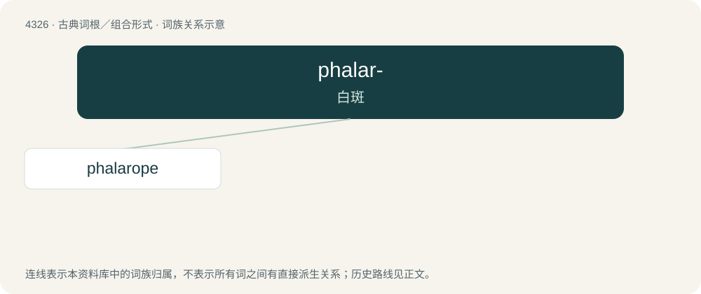

# 4328 · phalar- — 白斑

[总目录](../00_总目录_按常用程度.md)

**类型**：古典词根／组合形式　｜　**来源语言**：古希腊语

## 核心含义与来源

- 核心含义：白斑
- 英文含义：having a patch of white
- 词形：phalar-

**来源词形**：φάλαρος (phálaros)

## 词族图

## 单词速览（常用到不常用）

| 单词 | 音标 | 释义 |
|---|---|---|
| [phalarope](#w-1) | /ˈfæləɹəʊp/ | n. 瓣蹼鹬 |

## 逐词详解

### 1. phalarope

**词性**：名词　｜　**音标**：/ˈfæləɹəʊp/

**中文释义**：n. 瓣蹼鹬

**英文义项**：Any of three small wading birds in the genus Phalaropus, of the family Scolopacidae, that have lobed toes.

**词源与演化**：

From New Latin Phalaropus, formed irregularly from Ancient Greek φαλαρίς (phalarís, “coot”) + πούς (poús, “foot”).
