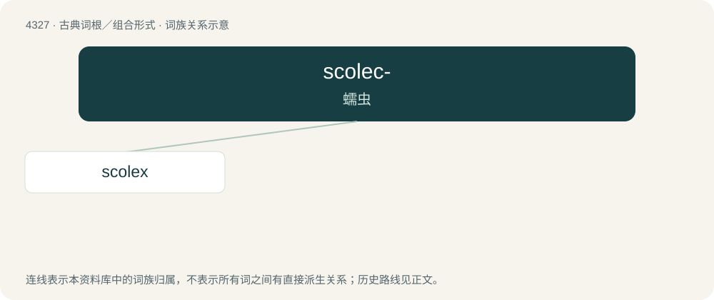

# 4329 · scolec- — 蠕虫

[总目录](../00_总目录_按常用程度.md)

**类型**：古典词根／组合形式　｜　**来源语言**：古希腊语

## 核心含义与来源

- 核心含义：蠕虫
- 英文含义：worm
- 词形：scolec-

**来源词形**：σκώληξ, σκώληκος (skṓlēx, skṓlēkos)

## 词族图

## 单词速览（常用到不常用）

| 单词 | 音标 | 释义 |
|---|---|---|
| [scolex](#w-1) | /ˈskəuleks/ | n. 绦虫, 头节；\[医\] 头节 |

## 逐词详解

### 1. scolex

**词性**：名词　｜　**音标**：/ˈskəuleks/

**中文释义**：n. 绦虫, 头节；\[医\] 头节

**英文义项**：The structure at the front end of a tapeworm which, in the adult, has suckers and hooks by which it attaches itself to a host.

**词源与演化**：

Borrowed from Ancient Greek σκώληξ (skṓlēx, “worm”).
