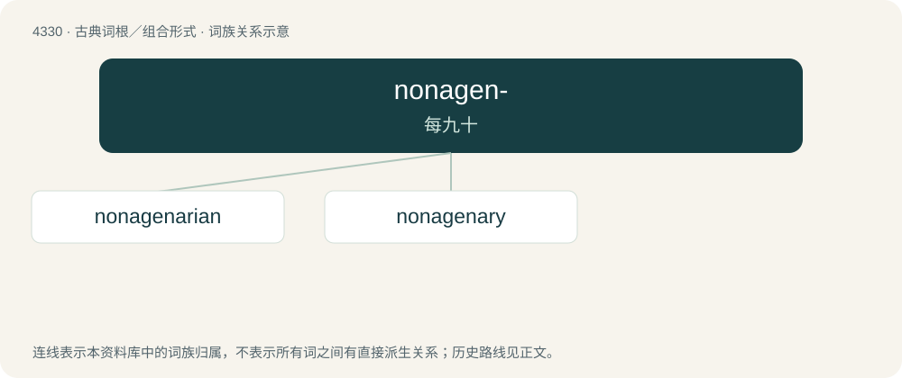

# 4330 · nonagen- — 每九十

[总目录](../00_总目录_按常用程度.md)

**类型**：古典词根／组合形式　｜　**来源语言**：拉丁语

## 核心含义与来源

- 核心含义：每九十
- 英文含义：ninety each
- 词形：nonagen-

**来源词形**：nonageni

## 词族图

## 单词速览（常用到不常用）

| 单词 | 音标 | 释义 |
|---|---|---|
| [nonagenarian](#w-1) | 英 /ˌnɒnəd͡ʒɪˈnɛːrɪən/；美 /ˌnɑnəd͡ʒɪˈnɛriən/ | a. 90至99岁的；n. 90至99岁的人 |
| [nonagenary](#w-2) | /ˈnɔnˈeidʒinəri/ | 九十进制的 |

## 逐词详解

### 1. nonagenarian

**词性**：名词　｜　**音标**：英 /ˌnɒnəd͡ʒɪˈnɛːrɪən/；美 /ˌnɑnəd͡ʒɪˈnɛriən/

**中文释义**：a. 90至99岁的；n. 90至99岁的人

**英文义项**：Synonym of ninetysomething: a person between 90 and 99 years old.

**词源与演化**：

From Latin nōnāgēnārius (“containing ninety”) + -an (suffix forming adjectives and representative nouns), either directly or via French nonagénaire, from nōnāgēnī (“ninety each”) + -ārius (“-ary”), from nōnāginta (“nine tens, ninety”).

### 2. nonagenary

**词性**：形容词　｜　**音标**：/ˈnɔnˈeidʒinəri/

**中文释义**：九十进制的

**英文义项**：Of or related to the number ninety.

**词源与演化**：

From Latin nōnāgēnārius (“containing 90”) either directly or via Middle French nonagénaire, from Latin nōnāgēnī (“90 each”) + -ārius (“-ary”), from nōnāgintā (“nine tens, 90”).
