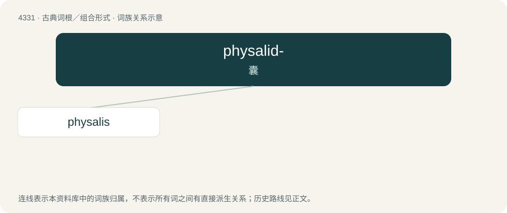

# 4331 · physalid- — 囊

[总目录](../00_总目录_按常用程度.md)

**类型**：古典词根／组合形式　｜　**来源语言**：古希腊语

## 核心含义与来源

- 核心含义：囊
- 英文含义：bladder
- 词形：physalid-

**来源词形**：φυσαλ(λ)ίς (phusal(l)is)

## 词族图

## 单词速览（常用到不常用）

| 单词 | 音标 | 释义 |
|---|---|---|
| [physalis](#w-1) | /ˈfɪsəlɪs/ | 【英文】Any plant of the genus Physalis. |

## 逐词详解

### 1. physalis

**词性**：名词　｜　**音标**：/ˈfɪsəlɪs/

**英文义项**：Any plant of the genus Physalis. / Fruit of such a plant, a yellow-orange berry, typically firm in texture with a mild, refreshing acidity.

**词源与演化**：

From New Latin Physalis, coined by Linnaeus from Ancient Greek φυσαλλίς (phusallís, “bladder, wind instrument”), from φυσιόω (phusióō, “to puff up, blow up”), φυσώ (phusṓ).
