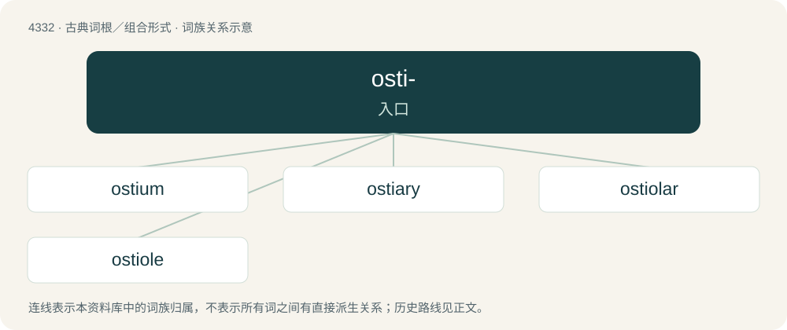

# 4332 · osti- — 入口

[总目录](../00_总目录_按常用程度.md)

**类型**：古典词根／组合形式　｜　**来源语言**：拉丁语

## 核心含义与来源

- 核心含义：入口
- 英文含义：entrance
- 词形：osti-

**来源词形**：ostium

## 词族图

## 单词速览（常用到不常用）

| 单词 | 音标 | 释义 |
|---|---|---|
| [ostium](#w-1) | /ˈɒstiəm/ | n. 口, 门, 孔；\[医\] 口, 门口 |
| [ostiary](#w-2) | /ˈɒsti.əɹi/ | n. 看门人；\[医\] 口的 |
| [ostiolar](#w-3) |  | 【英文】Of or pertaining to the ostiole. |
| [ostiole](#w-4) | /ˈɒstiəul/ | n. 小孔 |

## 逐词详解

### 1. ostium

**词性**：名词　｜　**音标**：/ˈɒstiəm/

**中文释义**：n. 口, 门, 孔；\[医\] 口, 门口

**英文义项**：A small opening or orifice, as in a body organ or passage. / Any of the small openings or pores in a sponge.

**词源与演化**：

Borrowed from Latin ōstium.

### 2. ostiary

**词性**：名词　｜　**音标**：/ˈɒsti.əɹi/

**中文释义**：n. 看门人；\[医\] 口的

**英文义项**：The mouth of a river; an estuary. / One who keeps the door, especially the door of a church; a porter.

**词源与演化**：

Borrowed from Latin ostiārius, from ostium (“door, entrance”). See usher, which may be a doublet.

### 3. ostiolar

**词性**：形容词

**英文义项**：Of or pertaining to the ostiole.

**构词拆分**：ostiole + -ar

**词源与演化**：

From ostiole + -ar.

### 4. ostiole

**词性**：名词　｜　**音标**：/ˈɒstiəul/

**中文释义**：n. 小孔

**英文义项**：A small hole or opening through which certain fungi release their mature spores. / A similar hole or opening in plants, such as the opening of the involuted fig inflorescence through which fig wasps enter to pollinate and breed.

**词源与演化**：

Borrowed from Latin ostiolum.
