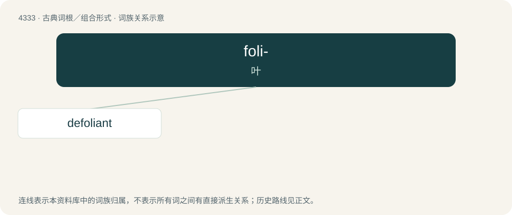

# 4333 · foli- — 叶

[总目录](../00_总目录_按常用程度.md)

**类型**：古典词根／组合形式　｜　**来源语言**：拉丁语

## 核心含义与来源

- 核心含义：叶
- 英文含义：leaf
- 词形：foli-

**来源词形**：folium

## 演化说明

folium“叶”产生 foli-；“叶片”可以引申为书页。foliage、folio、portfolio 的借入路线与现代用法不同，不能把每个 folio 都解释成植物叶。

## 词族图

## 单词速览（常用到不常用）

| 单词 | 音标 | 释义 |
|---|---|---|
| [defoliant](#w-1) | 英 /diːˈfəʊlɪənt/ | n. 脱叶剂, 落叶剂；\[化\] 脱叶剂 |

## 逐词详解

### 1. defoliant

**词性**：名词　｜　**音标**：英 /diːˈfəʊlɪənt/

**中文释义**：n. 脱叶剂, 落叶剂；\[化\] 脱叶剂

**英文义项**：An agent used to defoliate plants.

**构词拆分**：defoliate + -ant

**词源与演化**：

From defoliate + -ant.

**例句**：

> Agent Orange is a defoliant.

该用例对应义项：An agent used to defoliate plants.
