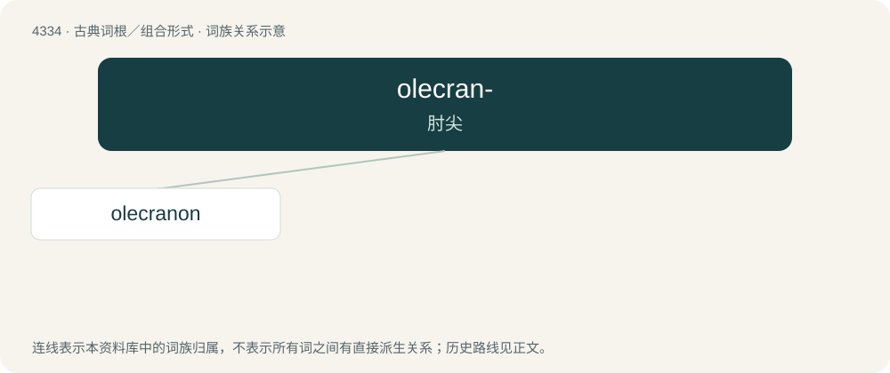

# 4334 · olecran- — 肘尖

[总目录](../00_总目录_按常用程度.md)

**类型**：古典词根／组合形式　｜　**来源语言**：拉丁语 ← 古希腊语

## 核心含义与来源

- 核心含义：肘尖
- 英文含义：skull of elbow
- 词形：olecran-

**来源词形**：ὠλέκρανον (ōlékranon)

## 词族图

## 单词速览（常用到不常用）

| 单词 | 音标 | 释义 |
|---|---|---|
| [olecranon](#w-1) | 英 /əˈlɛkɹənən/；美 /oʊˈlɛkɹəˌnɑn/ | n. \[解\]鹰嘴( 指肘部的骨性隆起) |

## 逐词详解

### 1. olecranon

**词性**：名词　｜　**音标**：英 /əˈlɛkɹənən/；美 /oʊˈlɛkɹəˌnɑn/

**中文释义**：n. \[解\]鹰嘴( 指肘部的骨性隆起)

**英文义项**：The bony process at the top of the ulna forming the point of the elbow.

**词源与演化**：

Borrowed from Ancient Greek ὠλέκρανον (ōlékranon).
