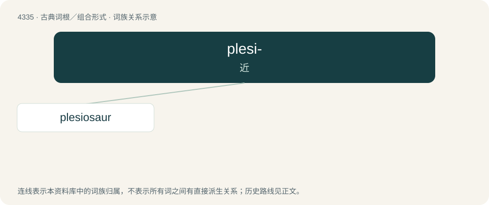

# 4335 · plesi- — 近

[总目录](../00_总目录_按常用程度.md)

**类型**：古典词根／组合形式　｜　**来源语言**：古希腊语

## 核心含义与来源

- 核心含义：近
- 英文含义：near
- 词形：plesi-

**来源词形**：πλησίος (plēsíos), πλησιότης (plēsiótēs)

## 词族图

## 单词速览（常用到不常用）

| 单词 | 音标 | 释义 |
|---|---|---|
| [plesiosaur](#w-1) | /ˈpliːsiəsɔːɹ/ | n. 蛇颈龙 |

## 逐词详解

### 1. plesiosaur

**词性**：名词　｜　**音标**：/ˈpliːsiəsɔːɹ/

**中文释义**：n. 蛇颈龙

**英文义项**：Any of the order †Plesiosauria of extinct marine reptiles, from the Jurassic and Cretaceous periods.

**构词拆分**：plesio- + -saur

**词源与演化**：

Backformation of translingual Plesiosaurus, named by William Conybeare and Henry De la Beche in 1824 because plesiosaurs were more like a normal reptile than Ichthyosaurus, which had been found in the same rock strata a few years earlier. Surface derivation, plesio- + -saur.

**例句**：

> Tom claims to have seen a plesiosaur in the lake.
