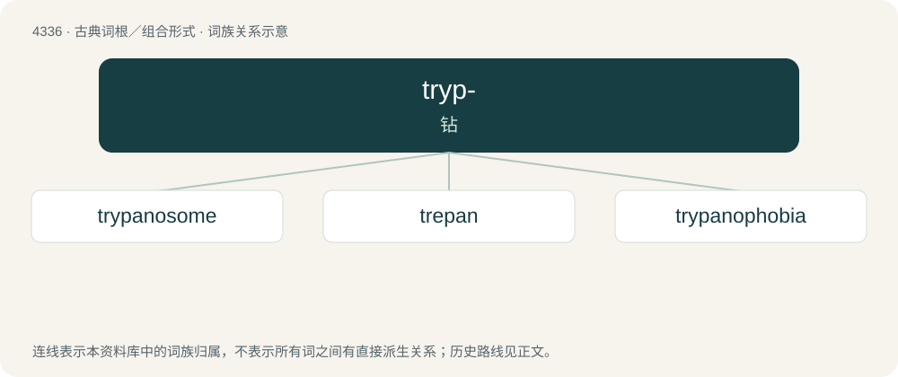

# 4336 · tryp- — 钻

[总目录](../00_总目录_按常用程度.md)

**类型**：古典词根／组合形式　｜　**来源语言**：古希腊语

## 核心含义与来源

- 核心含义：钻
- 英文含义：bore
- 词形：tryp-

**来源词形**：τρυπᾶν (trupân), τρύπανον (trúpanon)

## 词族图

## 单词速览（常用到不常用）

| 单词 | 音标 | 释义 |
|---|---|---|
| [trypanosome](#w-1) | /ˈtripənəsəum/ | n. 锥体虫；\[医\] 锥虫 |
| [trepan](#w-2) | 英 /tɹɪˈpæn/；美 /tɹəˈpæn/ | n. 环锯, 钻孔机；vt. 用环锯做手术, 诱入圈套, 欺骗 |
| [trypanophobia](#w-3) |  | 【英文】An irrational fear of medical procedures (such as injection) using needles. |

## 逐词详解

### 1. trypanosome

**词性**：名词　｜　**音标**：/ˈtripənəsəum/

**中文释义**：n. 锥体虫；\[医\] 锥虫

**英文义项**：Trypanosoma brucei, a major human pathogen that causes sleeping sickness. / Trypanosoma cruzi, a major human pathogen that causes Chagas disease.

**词源与演化**：

Learned borrowing from translingual Trypanosoma. By surface analysis, trypano- + -some.

### 2. trepan

**词性**：名词　｜　**音标**：英 /tɹɪˈpæn/；美 /tɹəˈpæn/

**中文释义**：n. 环锯, 钻孔机；vt. 用环锯做手术, 诱入圈套, 欺骗

**英文义项**：A tool used to bore through rock when sinking shafts. / A surgical instrument used to remove a circular section of bone from the skull; a trephine.

**词源与演化**：

Borrowed into Middle English from Old French trepan, from Latin trepanum, from Ancient Greek τρύπανον (trúpanon, “auger, borer”). Doublet of trephine.

### 3. trypanophobia

**词性**：名词

**英文义项**：An irrational fear of medical procedures (such as injection) using needles.

**构词拆分**：Ancient Greek τρῡ́πανον (trū́panon, “borer, trepan”) + -phobia

**词源与演化**：

From Ancient Greek τρῡ́πανον (trū́panon, “borer, trepan”) + -phobia. By surface analysis, trypano- + -phobia.
