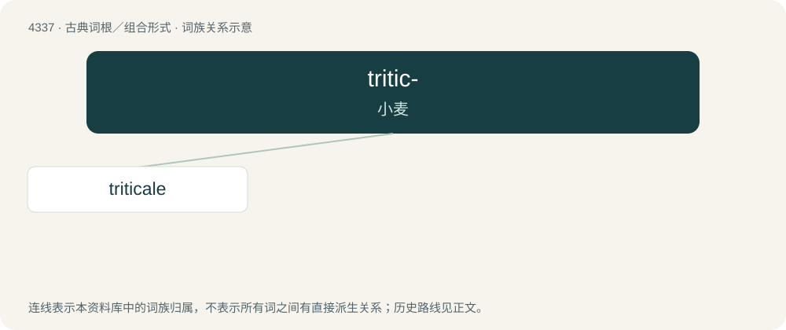

# 4337 · tritic- — 小麦

[总目录](../00_总目录_按常用程度.md)

**类型**：古典词根／组合形式　｜　**来源语言**：拉丁语

## 核心含义与来源

- 核心含义：小麦
- 英文含义：wheat
- 词形：tritic-

**来源词形**：triticum

## 词族图

## 单词速览（常用到不常用）

| 单词 | 音标 | 释义 |
|---|---|---|
| [triticale](#w-1) | /ˌtɹɪtɪˈkeɪli/ | n. (蛋白质丰富且高产的)小麦与黑麦的杂交麦,黑小麦 |

## 逐词详解

### 1. triticale

**词性**：名词　｜　**音标**：/ˌtɹɪtɪˈkeɪli/

**中文释义**：n. (蛋白质丰富且高产的)小麦与黑麦的杂交麦,黑小麦

**英文义项**：A grain crop, a hybrid of wheat and rye, that gives a high yield. / Any particular variety of triticale.

**词源与演化**：

Blend of Latin trīticum (“wheat”) + Latin sēcale (“rye”).
