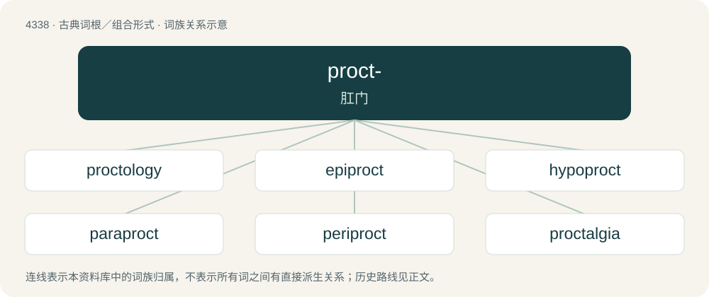

# 4338 · proct- — 肛门

[总目录](../00_总目录_按常用程度.md)

**类型**：古典词根／组合形式　｜　**来源语言**：古希腊语

## 核心含义与来源

- 核心含义：肛门
- 英文含义：anus
- 词形：proct-

**来源词形**：πρωκτός (prōktós)

## 词族图

## 单词速览（常用到不常用）

| 单词 | 音标 | 释义 |
|---|---|---|
| [proctology](#w-1) | 英 /ˌpɹɒkˈtɒləd͡ʒɪ/ | n. 直肠病学；\[医\] 直肠病学 |
| [epiproct](#w-2) | 英 /ˈɛpɪpɹɒkt/；美 /ˈɛpɪpɹɑkt/ | 肛上板 |
| [hypoproct](#w-3) |  | 【英文】The sclerite between the anal opening and the genitalia of an arthropod; the subanal plate. |
| [paraproct](#w-4) | /ˈpærə,prɔkt/ | (昆虫的)肛侧板 |
| [periproct](#w-5) | /ˈperi,prɔkt/ | n. (无脊椎动物的)围肛部 |
| [proctalgia](#w-6) |  | \[医\] 肛部痛 |

## 逐词详解

### 1. proctology

**词性**：名词　｜　**音标**：英 /ˌpɹɒkˈtɒləd͡ʒɪ/

**中文释义**：n. 直肠病学；\[医\] 直肠病学

**英文义项**：The branch of medicine dealing with the pathology of the colon, rectum, and anus. / The branch of medicine dealing with the surgery of the colon, rectum, and anus.

**构词拆分**：procto- + -logy；proct- + -ology

**词源与演化**：

From procto- + -logy or proct- + -ology.

### 2. epiproct

**词性**：名词　｜　**音标**：英 /ˈɛpɪpɹɒkt/；美 /ˈɛpɪpɹɑkt/

**中文释义**：肛上板

**英文义项**：Either of the lateral lobes of the proctiger.

**词源与演化**：

epi- + Ancient Greek πρωκτός (prōktós)

### 3. hypoproct

**词性**：名词

**英文义项**：The sclerite between the anal opening and the genitalia of an arthropod; the subanal plate.

### 4. paraproct

**词性**：名词　｜　**音标**：/ˈpærə,prɔkt/

**中文释义**：(昆虫的)肛侧板

**英文义项**：Any of various appendages surrounding the anus of some insects.

### 5. periproct

**词性**：名词　｜　**音标**：/ˈperi,prɔkt/

**中文释义**：n. (无脊椎动物的)围肛部

**英文义项**：The region surrounding the anus, particularly in echinoderms.

### 6. proctalgia

**词性**：名词

**中文释义**：\[医\] 肛部痛

**英文义项**：Pain in the anal or rectal region.

**构词拆分**：proct- + -algia

**词源与演化**：

From proct- + -algia.

## 其他候选词

- Ectoprocta
- Entoprocta
