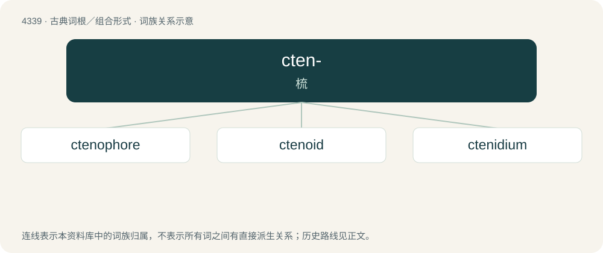

# 4339 · cten- — 梳

[总目录](../00_总目录_按常用程度.md)

**类型**：古典词根／组合形式　｜　**来源语言**：古希腊语

## 核心含义与来源

- 核心含义：梳
- 英文含义：comb
- 词形：cten-

**来源词形**：κτείς, κτενός (kteís, ktenós)

## 词族图

## 单词速览（常用到不常用）

| 单词 | 音标 | 释义 |
|---|---|---|
| [ctenophore](#w-1) | 英 /ˈtiː.nəˌfɔː/；美 /ˈtiː.nəˌfɔɹ/ | n. 栉水母 |
| [ctenoid](#w-2) | /ˈtiː.nɔɪd/ | a. 栉状的, 有栉齿状边缘的, 栉齿鳞科的 |
| [ctenidium](#w-3) | /tiˈnidiəm/ | n. 栉鳃 |

## 逐词详解

### 1. ctenophore

**词性**：名词　｜　**音标**：英 /ˈtiː.nəˌfɔː/；美 /ˈtiː.nəˌfɔɹ/

**中文释义**：n. 栉水母

**英文义项**：Any of various marine animals of the phylum Ctenophora, having lucent, mucilaginous bodies bearing eight rows of comblike cilia used for swimming.

**构词拆分**：cteno- + -phore

**词源与演化**：

Borrowed from translingual Ctenophora; equivalent to cteno- + -phore.

### 2. ctenoid

**词性**：形容词　｜　**音标**：/ˈtiː.nɔɪd/

**中文释义**：a. 栉状的, 有栉齿状边缘的, 栉齿鳞科的

**英文义项**：Having a toothed margin, usually fish scales / Comb-like in shape.

**构词拆分**：cteno- + -oid

**词源与演化**：

From cteno- + -oid.

### 3. ctenidium

**词性**：名词　｜　**音标**：/tiˈnidiəm/

**中文释义**：n. 栉鳃

**英文义项**：A respiratory system, in the form of a comb, in some molluscs / A row of spines in some insects

**词源与演化**：

Borrowed from Byzantine Greek κτενίδιον (ktenídion, “comb”). By surface analysis, cteno- + -idium.
